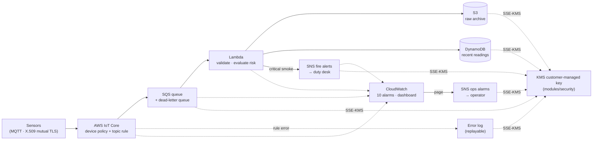

# PyroSense 🔥

> Serverless, event-driven AWS platform for **early wildfire detection** and **multi-stakeholder alerting**: sensors report, the cloud decides, the right people get alerted in seconds.

**Status:** the v1.0 serverless core is complete. All eight infrastructure modules have been **deployed, tested end to end on real AWS and destroyed**: 15,110 messages processed, **0 lost**, with the evidence published in this repository. CI/CD is in progress: every pull request now runs the full static quality gate as required checks; the Terraform plan and deploy pipeline with OIDC comes next.

| [▶ Test evidence](docs/evidence/README.md) | [Production readiness](docs/production-readiness.md) | [Design decisions](docs/adr/) |
|---|---|---|

---

## Why this project exists

In January 2024 wildfires burned the *Cerros Orientales*, the forested hills on Bogotá's eastern edge. The response exposed a familiar gap: by the time a fire is visible, it is already large, and the agencies involved (Bomberos Bogotá, IDIGER, the city's environmental authority SDA, the regional authority CAR and the water utility EAAB) learn about it through different channels at different times.

PyroSense explores how a cloud platform could close that gap: a network of sensors on the hillsides reports temperature, humidity and smoke; the cloud evaluates every reading, and a critical one becomes an alert to the duty desk within seconds, while every reading is kept for later analysis.

**This is a portfolio and learning project, built to a production standard.** It runs on simulated sensors and is deployed only for test cycles, but it is not a tutorial copy. Every decision was made the way a production team would make it:

- **Designed for production, deployed for demo.** The architecture is sized for a real fleet of about 500 sensors; the deployment is ephemeral and costs cents. Nothing in the design was simplified because the deployment is small.
- **Grounded in a real problem.** The scenario, the stakeholders and the failure modes come from the actual 2024 event, which is why the limitations of this design are documented as carefully as its features ([production readiness](docs/production-readiness.md)).
- **Every non-trivial decision is written down.** 22 Architecture Decision Records state the context, the decision, the alternatives rejected and when to revisit it.
- **Nothing is claimed without evidence.** Each module was deployed, exercised against real AWS services, verified and destroyed before it was merged; the full system was then tested end to end, including injected failures.
- **AI-assisted, human-owned.** AI tools drafted parts of the code. Every draft was reviewed against the official AWS and Terraform documentation before it was accepted, and the drafts that were wrong were rejected and the reasons recorded: a private key stored in Terraform state, a device policy that would have denied every real sensor, an alarm configuration that could never fire, among others.

---

## Proof it works

The complete system was deployed from nothing and tested for several hours on AWS. Full report, raw data and charts: **[docs/evidence/](docs/evidence/README.md)**.

| What was tested | Result |
|---|---|
| Messages through the real pipeline | **15,110 stored, 0 lost**, reconciled across IoT Core, SQS, Lambda, DynamoDB and S3 |
| 502 simulated sensors over MQTT with mutual TLS (X.509) | 10,040 messages, 0 missing · reading safely archived in p95 **1.06 s** |
| 5,000-message burst (a fleet reconnecting after an outage) | absorbed by the queue and drained in 273 s · 0 errors, 0 throttles |
| Fire scenario: 5 sensors report critical smoke | 5 alerts, one per sensor, published in p50 **1.18 s** · repeated readings suppressed |
| Injected failures: invalid payload, consumer outage, broken permission, lost alert | 4 of 4 detected and paged to the operator · no data lost |
| Security probes: other environment, impersonated device, unencrypted HTTP | 3 of 3 denied · 9 of 9 data stores encrypted with a customer-managed key |
| Monitoring | 10 of 10 alarms delivered their notification · a leftover from a test was caught by the drift check and fixed |
| Code quality | 95 tests · Terraform validate, TFLint, Trivy and gitleaks clean on the tested commit |


---

## How it works



<details>
<summary><b>Why the encryption arrows point toward KMS</b></summary>

Encryption arrows point **toward** KMS because that is the direction of the calls: each service requests a data key from KMS on the caller's behalf. That is why a consuming role needs `kms:GenerateDataKey` and `kms:Decrypt` in its own IAM policy even though the application code never mentions KMS (ADR-0010). IoT Core's message broker does not persist messages, so there is nothing at rest to encrypt there. The IoT topic rule's *role* is a different matter: it writes into the encrypted queue, so, like any other producer, it carries those two permissions in its own policy (`modules/iot`).

</details>

1. **The edge.** Each reading is published over MQTT, authenticated with an X.509 certificate. An IoT policy allows the fleet to publish only to telemetry topics of its own environment, with well-formed sensor IDs; anything else is denied and counted.
2. **The buffer.** An IoT topic rule forwards every message, unmodified, to an encrypted SQS queue. The queue absorbs bursts and retries failures, so a slow or failing consumer never loses data.
3. **The decision.** A Lambda function re-validates each reading against a strict data contract, archives the raw message in S3, stores it in DynamoDB, and, if smoke crosses the critical threshold, publishes a fire alert. A sensor that keeps reporting smoke produces one alert per 30 minutes, not one per reading.
4. **The watch.** Ten CloudWatch alarms cover every boundary: silence from the fleet, rejected devices, rule failures, queue backlog, dead-lettered messages, Lambda errors and throttles, per-message failures, lost alerts and undelivered alerts. Each one pages the operator.

> **Design principle:** sensors report conditions; they do not decide. The detection logic lives in the cloud, where it can be changed, audited and correlated across sensors.

---

## Designed not to lose a message

Losing a fire reading is the worst failure this system can have, so every point where a message could disappear has a protection, and each protection was tested.

| Where a message could be lost | Protection | Proven by |
|---|---|---|
| Device sends to the wrong place or with the wrong identity | Denied by the IoT policy and **counted**; an alarm pages on any denial | Security probes (E5) |
| The IoT rule cannot write to the queue | The message is kept in an encrypted error log and can be replayed byte for byte; an alarm pages | Injected failure E4c |
| The consumer stops or falls behind | Messages wait in the queue (4-day retention); a backlog-age alarm pages | Injected failure E4b |
| A message keeps failing | Retried 5 times, then kept in a dead-letter queue (14 days) for triage; an alarm pages | Injected failure E4a |
| Duplicate delivery (MQTT QoS 1 and SQS are at-least-once) | Idempotent writes: each reading is stored exactly once | Ledger: stored = received |
| A dependency fails for one message (S3, DynamoDB, KMS…) | Only that message is retried; an alarm pages when failures persist | Partial batch responses, E4d |
| The fire alert cannot be published | Detected, logged with the sensor ID and paged; recovery is manual in v1.0 | Injected failure E4d |
| The whole fleet goes silent | A heartbeat alarm pages after 10 minutes without readings | Observed throughout the run |

What this design does **not** yet guarantee is speed under failure: a message that fails repeatedly can take about 15 minutes to reach the dead-letter queue. For a fire, 15 minutes matters. That gap, and the others a real deployment would have to close, are in **[production readiness](docs/production-readiness.md)**.

---

## Demo vs. production (ADR-0002)

> **"Design for production, deploy for demo."**

The architecture is designed for a production fleet, but deployed ephemerally at near-zero cost: each test cycle creates the stack, exercises it and destroys it, and only a budget alarm stays in the account. Terraform is parametrized for both environments (`demo` / `prod` through `.tfvars`), and everything that differs between them is an explicit variable with a safe default, so the difference is visible in a diff rather than hidden in code. The limits that come from deploying small are measured and listed in [observed limits](docs/evidence/v1.0-2026-10-15/observed-limits.md); a production cost model with AWS Pricing Calculator is a planned stage.

---

## Tech stack

| Layer | Choice |
|---|---|
| Ingestion | AWS IoT Core: MQTT, X.509 mutual TLS, topic rule → SQS, error action to a dedicated log |
| Buffering | Amazon SQS standard queue + dead-letter queue, SSE-KMS, TLS-only policy |
| Compute | AWS Lambda: Python 3.12, arm64 (Graviton), standard library only, SQS event source with partial batch responses |
| Hot state | Amazon DynamoDB: single-table design, conditional writes, TTL, point-in-time recovery |
| Cold storage | Amazon S3: raw archive, SSE-KMS with bucket key, versioning, public access blocked |
| Alerting | Amazon SNS: separate fire-alert and operations topics, both KMS-encrypted |
| Observability | Amazon CloudWatch: 10 alarms, log metric filters, embedded metrics (EMF), dashboard |
| Security | AWS KMS customer-managed key with rotation · least-privilege IAM with KMS conditions · TLS enforced by policy |
| Cost control | AWS Budgets guardrail · ephemeral deployments |
| Infrastructure as Code | Terraform ≥ 1.11, 8 modules, remote S3 state with native locking |
| Quality gate | terraform fmt/validate, TFLint, Trivy, gitleaks, ruff, mypy (strict), pytest + moto (90 % branch-coverage floor), actionlint, pre-commit |
| CI/CD | GitHub Actions: the full static gate as four required checks; Terraform plan and deploy with OIDC next |

---

## Continuous integration

Every pull request and every push to `develop` and `main` runs four required checks. Each one calls the same `make` targets used locally, so the gate is defined once, in the `Makefile`.

| Check | Runs | Fails on |
|---|---|---|
| `python` | `make py-lint py-type py-test` | ruff findings or formatting, mypy (strict), a failing test, branch coverage below 90 % |
| `terraform` | `make fmt-check validate lint` | unformatted HCL, schema errors in any root, a provider missing from the committed lock file, TFLint findings |
| `security` | `make sec` | Trivy HIGH/CRITICAL findings, a file Trivy could not parse, a secret anywhere in the git history |
| `hygiene` | `make guard ci-lint` | a tracked plan, state, tfvars, backend config, CSR or key; a real email address or AWS account id in a committed `*.example` template; actionlint findings in the workflows |

A repository ruleset makes the four checks required on `develop` and `main`, requires a pull request and allows no bypass. CI needs no cloud credentials.

**Pinned toolchain.** Versions live in `.tool-versions` (binaries and Python) and `requirements-dev.txt` (Python packages). CI installs each binary only after checking it against a SHA-256 committed in `scripts/tooling/checksums.txt`, and every third-party action is pinned to a full commit SHA. Trivy uses the checks embedded in the pinned binary, so the same commit always gets the same verdict. `make tools` compares your local toolchain with the pins (ADR-0022).

---

## Repository structure

```text
.
├── README.md
├── Makefile                   # task shortcuts; `make check` runs the full static gate
├── .tool-versions             # pinned toolchain: Python, Terraform, TFLint, Trivy, gitleaks, actionlint
├── pyproject.toml             # Python tooling (ruff, mypy, pytest, coverage)
├── requirements-dev.txt       # Python dev dependencies, pinned exactly
├── trivy.yaml  .tflint.hcl    # scanner and lint configuration (shared by local runs and CI)
├── main.tf  variables.tf  outputs.tf  versions.tf  providers.tf   # root: composition only
├── demo.tfvars.example  prod.tfvars.example                       # per-environment inputs (real ones are gitignored)
├── bootstrap/state-backend/   # one-time remote state bucket
├── config/                    # backend configuration (example committed)
├── modules/                   # one folder per concern, each with its README
│   ├── budgets/               # account-wide cost guardrail
│   ├── security/              # pipeline KMS key and key policy
│   ├── messaging/             # SQS queue + dead-letter queue
│   ├── storage/               # DynamoDB table + S3 archive
│   ├── alerting/              # SNS fire-alert and operations topics
│   ├── iot/                   # device identity, IoT policy, topic rule → SQS
│   ├── ingest/                # Lambda consumer, its role, the SQS event source
│   └── observability/         # alarms, log metric filters, dashboard
├── src/ingest_lambda/         # Lambda source (Python 3.12, stdlib only)
├── tests/                     # pytest suite (moto: no AWS account needed)
├── scripts/                   # operator helpers; scripts/iot has the MQTT test publisher
│   └── tooling/               # hash-verified tool installer, version check, Trivy gate
├── docs/
│   ├── adr/                   # Architecture Decision Records
│   ├── evidence/              # end-to-end test evidence (start here)
│   ├── github/                # repository ruleset, kept as code
│   └── production-readiness.md
└── .github/workflows/         # CI: four required checks
```

---

## Getting started

**Prerequisites**

- An AWS account with programmatic access.
- AWS CLI ≥ 2.32.0 (`aws login` for temporary, auto-refreshing credentials; no long-lived access keys).
- Terraform ≥ 1.11 (native S3 state locking with `use_lockfile = true`); the gate and CI use the exact version in `.tool-versions`.
- **Python 3.12**, the Lambda runtime target; the test suite requires 3.12 or newer.
- Quality gate tooling at the versions pinned in `.tool-versions`: `tflint`, `trivy`, `gitleaks` and `actionlint` (on Linux x86_64, `scripts/tooling/install-tool.sh <tool>` installs each one after verifying its checksum), plus `pre-commit`, and `jq` to inspect the plan before applying. `make tools` reports any version that differs from the pins.
- `openssl`, to generate the device key pair and certificate request locally (see `modules/iot/README.md`).

**Run the test suite** (no AWS account needed):

```bash
python3.12 -m venv .venv && source .venv/bin/activate
pip install -r requirements-dev.txt
pytest              # 95 tests
```

> The suite runs entirely against an in-memory AWS (moto): no account, no credentials, no cost. See `tests/README.md`.

**Deploy** (creates billable resources; destroy them when you are done):

1. Create the state bucket once with `bootstrap/state-backend` (see its README) and write `config/backend.hcl` from the example.
2. Copy `demo.tfvars.example` to `demo.tfvars` and set your own email recipients.
3. Generate the device key pair and certificate request locally; the private key never enters Terraform (see `modules/iot/README.md`).
4. Then:

```bash
terraform init -backend-config=config/backend.hcl
make check                                         # the full static quality gate
terraform plan -var-file=demo.tfvars -out=tfplan
terraform apply tfplan
```

5. Confirm the two email subscriptions **from the CLI**, not by clicking the link (see `scripts/alerting/`), and send test telemetry with `scripts/iot/`.

> Re-run `terraform init` whenever a new module block is added to `main.tf`.

> Inspect the plan before applying. A green static gate does not prove the plan contains what you expect, so verify the artifact itself:
>
> ```bash
> terraform show -json tfplan | jq -r '.resource_changes[].address'
> ```
>
> Never commit `tfplan`: a saved plan contains sensitive values in clear text.

---

## Roadmap

| Area | Status |
|---|---|
| Lambda consumer (Python) | ✅ Complete · 95 tests |
| CI quality gate (GitHub Actions) | ✅ Full static gate (Python, Terraform, security, hygiene) as required checks on every pull request |
| Remote state backend · cost guardrail | ✅ Deployed |
| Encryption · messaging · storage · alerting · IoT · ingest · observability | ✅ Each verified in its own deploy/destroy cycle |
| End-to-end evidence run (whole system on AWS) | ✅ [Published](docs/evidence/README.md) |
| CI/CD: Terraform pipeline with GitHub Actions and OIDC | ⬜ **Next** |
| Production cost model (AWS Pricing Calculator) | ⬜ Planned |
| Historical analysis (Athena over the S3 archive) | ⬜ Planned |
| Production hardening | ⬜ See [production readiness](docs/production-readiness.md) |

---

## Design decisions

Every significant decision is an ADR under [`docs/adr/`](docs/adr/).

| # | Decision |
|---|---|
| 0001 | Remote state on S3 with native lockfile locking |
| 0002 | Design for production, deploy for demo |
| 0003 | Account-wide monthly budget as the cost guardrail |
| 0004 | Tags set once at the provider, not per resource |
| 0005 | Alert suppression: race-free slot, claimed before publishing |
| 0006 | Contract-first re-validation at the consumer boundary |
| 0007 | Dependency-free Lambda (standard library only) |
| 0008 | At-least-once delivery handled by idempotent conditional writes |
| 0009 | Observability: JSON logs on stderr, EMF metrics on stdout |
| 0010 | A single customer-managed KMS key for the whole pipeline |
| 0011 | Retry contract: visibility timeout derived from the consumer, dead-letter queue outlives its source |
| 0012 | Permanent (contract) failures stay on the retry path |
| 0013 | Storage: single-table key design and a flat cold archive |
| 0014 | Alerting: one module with two purpose-built topics, keyed by recipient labels |
| 0015 | Email as the only alert channel in v1.0, scoped as non-life-safety |
| 0016 | IoT: one fleet identity and one IoT policy |
| 0017 | IoT: device certificate issued from a CSR; private key never in Terraform state |
| 0018 | IoT: topic rule → SQS, no filtering, error action to a dedicated log group |
| 0019 | Ingest consumer: runtime, configuration contract, concurrency and IAM scoping |
| 0020 | Detection policy: ownership and provisional values |
| 0021 | Observability: one fault, one page; fleet silence as a breaching heartbeat |
| 0022 | CI quality gate and pinned, hash-verified toolchain |

---

## License

See [LICENSE](LICENSE).
