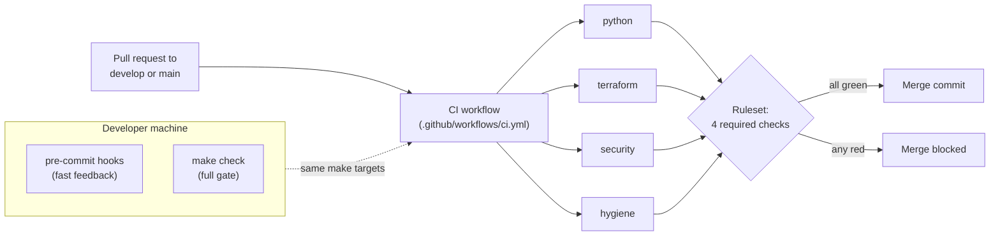
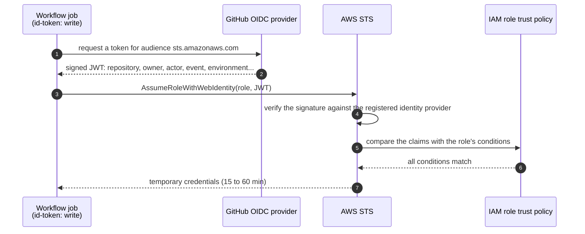
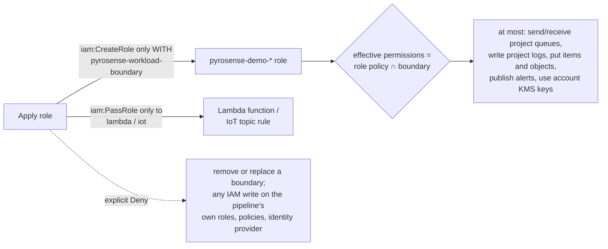

# PyroSense — CI/CD

How changes reach this repository's main branches, why the pipeline is built
the way it is, and how each part of it was proven to work. Decisions are
recorded in ADRs; this page explains them together, for someone reading the
repository for the first time.

| Stage | What it adds | Status |
|---|---|---|
| **C1 — Static CI** | The full quality gate runs on every pull request as four required checks | ✅ Done · [evidence](evidence/ci-c1-2026-10-23/README.md) · [ADR-0022](adr/) |
| **C2 — Pipeline identity** | AWS access for the pipeline through OIDC: no stored keys, a read-only plan role and a scoped apply role that cannot escalate | 🔄 In progress · [section 8](#8-pipeline-identity-c2) · [ADR-0023](adr/0023-pipeline-identity-oidc-and-workload-boundary.md) |
| C3 — Plan in pull requests | `terraform plan` on every pull request, summarised without sensitive values | ⬜ Planned |
| C4 — Manual delivery to `demo` | Deploy and destroy from the pipeline, behind a human approval | ⬜ Planned |
| C5 — Upkeep | Dependency updates and scheduled drift detection | ⬜ Planned |

PyroSense follows **continuous delivery, not continuous deployment**: every
change is verified automatically, but a person decides when infrastructure is
applied. The demo environment is ephemeral (deployed, tested and destroyed) and
email subscriptions need a human to confirm them, so applying on every merge
would create resources nobody is using.

---

## 1. The pipeline at a glance



The four jobs run in parallel on fresh GitHub-hosted runners (`ubuntu-24.04`).
Each one calls the same `make` targets a developer runs locally:

| Check | Runs | Fails on |
|---|---|---|
| `python` | `make py-lint py-type py-test` | ruff findings or formatting, mypy (strict), a failing test, branch coverage below 90 % |
| `terraform` | `make fmt-check validate lint` | unformatted HCL, schema errors in any root, a provider missing from the committed lock file, TFLint findings |
| `security` | `make sec` | Trivy HIGH/CRITICAL findings, a file Trivy could not parse, a secret anywhere in the git history |
| `hygiene` | `make guard ci-lint` | a tracked plan, state, tfvars, backend config, CSR or key; a real email or AWS account id in a committed template; actionlint findings |

A repository ruleset ([docs/github/ruleset-protected-branches.json](github/ruleset-protected-branches.json))
protects `develop` and `main`:
- the four checks are required;
- changes arrive only through a pull request, merged with a merge commit;
- force pushes and branch deletion are blocked;
- the bypass list is empty, so the repository owner cannot skip it either.

C1 needs **no cloud credentials**: the gate is static and runs offline from AWS.

---

## 2. Why it is built this way

Each principle below names the decision, the reason, and the alternative that
was rejected. The full record is ADR-0022.

### 2.1 One gate, defined once

The `Makefile` is the only place where the gate is defined. The pre-commit
hook, `make check` and CI all call it:

| Where | When | Can it be skipped? |
|---|---|---|
| pre-commit | On every commit, on the developer's machine | Yes (`--no-verify`). It is early feedback, not the authority |
| `make check` | When the developer runs it | Yes |
| CI + ruleset | On every pull request and push to `develop`/`main` | No |

*Rejected:* writing the gate's commands directly in the workflow YAML. Two
copies of a gate drift apart. Before this stage, the hook, the local gate and
CI disagreed on the version of ruff, and CI did not run the Terraform or
secret checks at all.

### 2.2 Every check required, nothing filtered

The workflow has no `paths:` filter. A required check whose workflow is
filtered out never reports, so the pull request either waits forever or the
check is relaxed. Before this stage, a change limited to `scripts/` merged with
no check at all.

*Rejected:* path filters to save minutes. Standard GitHub-hosted runners are
free for public repositories, so the filter saved nothing and hid changes.

### 2.3 Nothing runs unless it is pinned and verified

The pipeline executes code written by others: actions, scanners, linters,
Python packages. Two real incidents shaped this part:

- **tj-actions/changed-files** (CVE-2025-30066, March 2025): attackers moved
  existing version tags to a malicious commit that printed secrets into
  workflow logs, which are public in public repositories.
- **Trivy** (GHSA-69fq-xp46-6x23, March 2026): a malicious Trivy release was
  published, and the `setup-trivy` and `trivy-action` tags were hijacked.

So:
- **Actions** are pinned to a full commit SHA, with the version in a comment.
  Only first-party actions are used (`actions/*`, `hashicorp/setup-terraform`).
- **Binaries** (TFLint, Trivy, gitleaks, actionlint) are installed by
  [`scripts/tooling/install-tool.sh`](../scripts/tooling/install-tool.sh),
  which checks each download against a SHA-256 committed in this repository.
  A release whose files *and* checksums were both replaced still fails here,
  because the attacker controls the release page, not this repository.
- **Versions** live in one place per kind: `.tool-versions` for binaries and
  Python, `requirements-dev.txt` (exact pins) for Python packages,
  `.terraform.lock.hcl` for providers.
- **Cooldown:** a new version is adopted only after it has been public for 14
  days, unless it fixes a vulnerability that affects this repository.

*Rejected:* `setup-trivy` or `trivy-action`, which were part of the 2026
compromise and fetch an install script at runtime.

### 2.4 The same commit always gets the same verdict

A gate whose result changes without any change in the repository cannot be
trusted:
- Trivy uses the checks **embedded in the pinned binary** instead of
  downloading the latest rules on every run. Rules move forward when the
  binary is bumped, through a reviewed pull request.
- `terraform init -lockfile=readonly` verifies the committed lock file and
  never rewrites it. A provider added without updating the lock fails the gate.
- The workflow refuses to run with a Terraform version that is not an exact
  `X.Y.Z`. `setup-terraform` silently installs the *latest* release when the
  version is empty or malformed, which would turn a missing pin into a green
  check on a different Terraform.

*Rejected:* a floating rules bundle, which gives fresher rules at the cost of
verdicts that change without any change in the code.

### 2.5 A scanner that cannot read a file must not pass it

Trivy logs `Error parsing file` and still exits successfully, even when it is
told to fail on findings. A file it cannot parse is a file it did not scan.
[`scripts/tooling/trivy-gate.sh`](../scripts/tooling/trivy-gate.sh) fails the
gate on any parse error. Trivy also scans only Terraform source: by default it
also parses saved plans, and a stray `tfplan` once broke a run.

### 2.6 Public by default: nothing sensitive in the logs

The repository is public, and so are its workflow logs to any signed-in GitHub
user. Every part of the pipeline assumes its output will be read by strangers:
- the workflow token is read-only (`permissions: contents: read`), and no job
  keeps the git credential on disk (`persist-credentials: false`);
- the guard reports `file:line`, never the value it found;
- the secret scan prints rule, file, line and commit, never the secret or the
  commit author's email;
- the logs of the first green run were downloaded and searched for the AWS
  account id and the operator's email: **0 occurrences** of each.

### 2.7 Secrets: several layers, because detection after a push is too late

In a public repository, a secret is exposed the moment it is pushed. A red CI
check after the push protects `develop`, not the secret. So there are layers:

| Layer | When | Kind |
|---|---|---|
| gitleaks pre-commit hook | Before the commit exists | Prevention (can be skipped) |
| GitHub push protection | During the push | Prevention |
| `make secrets` in CI, over the **whole history** | After the push | Detection; blocks the merge |
| Rotation | After any leak | Response |

The CI scan covers every commit, not only the files on disk: a secret added in
one commit and deleted in the next is still in the public history.

---

## 3. How each gate was proven

A gate that has never failed has not been tested. For every gate, a pull
request was built **to fail on purpose**. Each one had to go red on the right
check, the ruleset had to block its merge, and the failed log had to contain
the expected message. All of them were then closed without merging.

| # | Provocation | Expected red check | Blocked | Message found in the log |
|---|---|---|---|---|
| 1 | Badly formatted `.tf` | `terraform` | ✅ | `main.tf` (fmt) |
| 2 | Reference to an output that does not exist | `terraform` | ✅ | `Unsupported attribute` |
| 3 | Variable without a description | `terraform` | ✅ | `terraform_documented_variables` |
| 4 | Provider added without updating the lock file | `terraform` | ✅ | `hashicorp/random` |
| 5 | Terraform pin removed from `.tool-versions` | `terraform` | ✅ | `must be pinned to an exact X.Y.Z version` |
| 6 | SSH open to the internet | `security` | ✅ | `AWS-0107` |
| 7 | A `.tf` file that cannot be parsed | `security` + `terraform` | ✅ | `trivy-gate: Trivy could not parse` |
| 8 | A fake key committed, then deleted in the next commit | `security` | ✅ | `gitleaks: generic-api-key` |
| 9 | Unused import | `python` | ✅ | `F401` |
| 10 | Wrong return type | `python` | ✅ | `Incompatible return value` |
| 11 | A failing test | `python` | ✅ | `test_provocation_fails` |
| 12 | Coverage floor raised to 100 % (actual 99.28 %) | `python` | ✅ | `Required test coverage of 100%` |
| 13 | A `.tfvars` forced past `.gitignore` | `hygiene` | ✅ | `zz-provocation.tfvars` |
| 14 | A real-looking email inside a template | `hygiene` | ✅ | `outside the example domains (value not shown)` |
| 15 | A workflow expression pointing to a step that does not exist | `hygiene` | ✅ | `property "pin" is not defined` |

**15 of 15 blocked.** Three more checks complete the proof:
- the first green run passed all four checks;
- a direct push to `develop` was rejected by the ruleset (`GH013`);
- in provocation 14, the planted address appears **0 times** in the public log.

Raw results: [docs/evidence/ci-c1-2026-10-23/](evidence/ci-c1-2026-10-23/README.md).

---

## 4. What proving it found

Testing the gate found problems in the gate itself. They are reported here as
they happened.

| Found | Why it mattered | Outcome |
|---|---|---|
| The secret scan said only `leaks found: 1` | A red check nobody can act on. `--verbose` would have published the commit author's email in a public log | **Fixed:** `scripts/tooling/gitleaks-gate.sh` prints rule, file, line and commit from a JSON report, and nothing about the author |
| actionlint did not catch a misspelled `with:` input | actionlint knows action inputs by *tag*; with actions pinned by SHA, it cannot look them up. Pinning for security costs this check | **Accepted limitation** (ADR-0022): inputs of pinned actions are reviewed by hand. Provocation 15 was redesigned to test what actionlint does catch here |
| A leak on one branch failed the security check of unrelated pull requests | The history scan reads every branch the clone fetches | **Accepted** (ADR-0022): in a public repository a secret on any branch is already exposed, so stopping every merge until it is purged is the intended response |
| The package manager upgraded Trivy (0.76.1) and Terraform (1.17.0) on the operator's machine within a week, without any change in the repository | The local gate would have used different tools from CI | `make tools` caught both; the pinned versions were restored. This is why version checks are part of the setup |
| The operating system's Python was 3.12.3; the pin is 3.12.13 | Pinning CI to the distribution's patch would mean running ~two years of missing fixes | The pinned version is installed with `uv`, without touching the system Python |

---

## 5. Measured

| Metric | Value |
|---|---|
| Duration of a full run (four jobs in parallel) | ~49 s wall clock. `python` 49 s · `terraform` 36 s · `security` 9 s · `hygiene` 5 s |
| Cost | $0: standard GitHub-hosted runners are free for public repositories |
| Sensitive values in the public log of the green run | 0 account id · 0 email (1,261 log lines searched) |
| Provoked failures blocked | 15 of 15 |

---

## 6. Known limitations

- **One maintainer.** Nobody can approve their own pull request, so the
  ruleset requires zero approvals. The checks catch what they were written to
  catch; nobody else reads the change. See production readiness, section 9.
- **actionlint cannot validate inputs of SHA-pinned actions** (see section 4).
- **Transitive Python dependencies are not locked**; only direct ones are.
- **Pins do not update themselves** until an update bot is added (C5).
- **Hashes prove integrity, not origin.** Signature or attestation checks are
  not part of the gate.

What a production deployment would need instead:
[production readiness, section 9](production-readiness.md#9-delivery-pipeline-cicd).

---

## 7. Working with the pipeline

**Set up the toolchain** (Linux x86_64):

```bash
uv python install 3.12.13                               # the Python pinned in .tool-versions
uv venv --seed --python 3.12.13 .venv
.venv/bin/python -m pip install -r requirements-dev.txt
for t in tflint trivy gitleaks actionlint; do scripts/tooling/install-tool.sh "$t"; done
make tools                                             # every line must say "ok"
pre-commit install
```

Terraform is installed separately at the version in `.tool-versions`. On a
machine where the package manager updates it, hold that version.

**Before opening a pull request:** run `make check`. CI runs the same targets.

**Merging:** open a pull request to `develop`. Direct pushes are rejected. When
the four checks are green, merge with a merge commit.

**When a check fails:** open the failed job. Each check maps to `make`
targets, so the same command reproduces the failure locally.

**Bumping a tool:**
1. Wait until the release is at least 14 days old.
2. Update `.tool-versions` and the matching line in
   `scripts/tooling/checksums.txt`, taking the hash from the release's own
   checksums file.
3. Re-run `make tools` and `make check`, and open a pull request.

**If a secret is ever pushed:** rotate it first. Deleting the commit does not
un-publish it.

---

## 8. Pipeline identity (C2)

C1 runs without any cloud access. From C3 on, the pipeline has to call AWS:
`terraform plan` in pull requests, then apply and destroy of `demo`. This
section explains how it gets that access and why that access cannot be
turned against the account. The decision record is ADR-0023; the code is
[`bootstrap/ci-identity/`](../bootstrap/ci-identity/).

### 8.1 No keys: credentials that exist for one job



No access key exists for the pipeline, so none can leak from a secret store
or a log. `id-token: write` only lets the job *ask* GitHub for a token; what
the token is worth is decided in AWS, by the role's trust policy.

### 8.2 Two roles

| | `pyrosense-ci-plan` | `pyrosense-ci-apply-demo` |
|---|---|---|
| Used by | `terraform plan` in pull requests (C3) | apply and destroy of `demo` (C4) |
| Assumable from | a pull request of this repository | a job in the GitHub environment `demo`, after the maintainer approves it |
| Reads | project configuration (no data), main state | the same |
| Writes | only the state lock file | the state, and resources named `pyrosense-demo-*` |
| Can create IAM roles | no | only `pyrosense-demo-*` roles that carry the workload boundary |

Splitting them keeps the job that runs on every pull request unable to change
anything. The environment approval happens **before** the job starts: until
the maintainer approves, there is no runner, no token and no environment
secret.

### 8.3 Who can assume them: the trust policies

Every condition is an exact match (`StringEquals`). A missing or misspelled
claim fails closed.

| Claim | Plan role | Apply role | Why |
|---|---|---|---|
| `aud` | `sts.amazonaws.com` | `sts.amazonaws.com` | the token was minted for AWS |
| `sub` | `repo:<owner>@<id>/<repo>@<id>:pull_request` | `repo:<owner>@<id>/<repo>@<id>:environment:demo` | this repository **and** this context |
| `repository_id`, `repository_owner_id` | this repository's ids | the same | numeric ids cannot be re-registered by someone else after a rename or deletion |
| `actor_id` | the maintainer | the maintainer | a run started by anyone else gets no credentials, including a pull request from a fork |

The `sub` uses GitHub's **immutable** format (owner and repository carry
their numeric ids), the default for repositories created on or after
2026-07-15.

### 8.4 What they can do, and why the apply role cannot escalate

The apply role has to create IAM roles: the configuration creates the two IoT
topic rule roles and the Lambda execution role. Any identity that can write a
role's policy and hand that role to a Lambda function it creates can run code
with any permission it likes. Limiting role names does not help:
`pyrosense-demo-anything` is a valid name.

A **permissions boundary** closes this. It is a ceiling: a role's effective
permissions are the intersection of its own policies and its boundary.



So a role created by the pipeline with `"Action": "*"` still gets, at most,
the data path of PyroSense. The modules keep granting each role exactly what
it needs (one queue, one table, one key); the boundary only caps what any
pipeline-created role could ever reach.

How each permission is scoped, tightest first:

| Scope | Used for |
|---|---|
| One object | the state file and its lock file |
| Name prefix `pyrosense-demo-*` | queues, topics, tables, buckets, roles, functions, log groups, alarms, IoT things, policies and rules |
| Tags `Project=PyroSense`, `Environment=demo` | KMS keys: their ARN is a random id, so the tags are checked when a key is created and on every later call |
| `*` | configuration reads, and creates that have no ARN yet (`kms:CreateKey` with the tag condition, `iot:CreateCertificateFromCsr`, event source mappings limited by function ARN) |

### 8.5 Where the permission list came from

Not from a tutorial and not from `AdministratorAccess` trimmed by trial and
error. CloudTrail Event History recorded every call Terraform made during
three full deploy/destroy cycles (2026-10-14..20): **116 distinct API calls
across 12 services**. That list was necessary but not sufficient:

| Gap | Example | How it was closed |
|---|---|---|
| API name ≠ IAM action | `PutBucketEncryption` → `s3:PutEncryptionConfiguration`; `CreateFunction20150331` → `lambda:CreateFunction` | translated by hand |
| Permissions that never appear as events | `iam:PassRole`, `iam:TagRole` behind a create with tags, `kms:CreateGrant` used by Lambda and DynamoDB | AWS service authorization reference |
| Data events are not in Event History | `sqs:GetQueueAttributes`, S3 object deletes when emptying a bucket on destroy | added from the provider's behaviour |

It is a first version. C3 runs every read for real and C4 every write; an
`AccessDenied` there is a missing line, added with its reason, never a
wildcard.

### 8.6 Where the identity lives

The pipeline identity must outlive every `demo` cycle and must not be
editable by the pipeline itself, so it is a separate, long-lived stack,
applied by the operator:

| Stack | State | Applied by | Lifetime |
|---|---|---|---|
| `bootstrap/state-backend` | local (cannot store its own state) | operator | permanent |
| `bootstrap/ci-identity` | state bucket, own key, unreadable by the pipeline roles | operator | permanent |
| main configuration | state bucket, `pyrosense/terraform.tfstate` | operator today; the pipeline from C4 | `demo`: one test cycle |

The main configuration reads the boundary by name. If `bootstrap/ci-identity`
has not been applied, `terraform plan` fails on that lookup before anything
is created.

### 8.7 GitHub configuration

| Setting | Value | Why |
|---|---|---|
| Repository secret `AWS_PLAN_ROLE_ARN` | output `plan_role_arn` | an ARN contains the account id; a non-secret `with:` input is printed in the public log |
| Environment `demo` → required reviewer | the maintainer | nothing deploys without a person deciding it |
| Environment `demo` → deployment branches | the default branch | changes reach AWS only after review and merge |
| Environment `demo` → secret `AWS_APPLY_ROLE_ARN` | output `apply_role_arn` | unavailable to a job until the reviewer approves |

### 8.8 How it is proven

[`.github/workflows/oidc-probe.yml`](../.github/workflows/oidc-probe.yml) gets
real credentials and creates nothing. For each role it shows the claims AWS
evaluated and the role it became, then asserts that forbidden actions are
**refused by AWS**:

| Job | Must be allowed | Must be refused |
|---|---|---|
| `plan-role` (pull requests touching the identity) | assume the plan role; find the boundary by name | create a queue; assume the apply role from a pull request |
| `apply-role` (manual, environment `demo`) | assume the apply role; find the boundary by name | create a role **without** the boundary; create a `pyrosense-prod-*` resource; tag the pipeline's own role |

Results and evidence: added when C2 closes.
