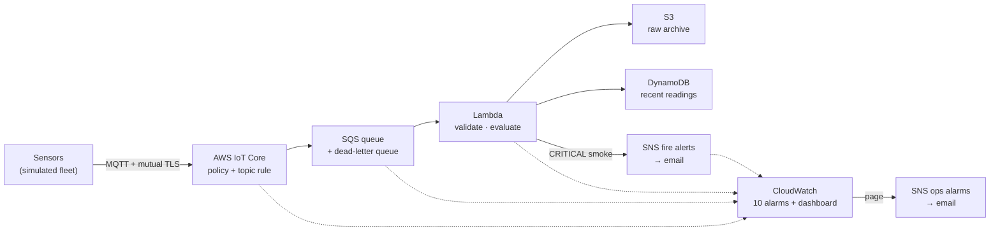

# PyroSense — End-to-end test evidence

This folder holds the results of testing PyroSense on **real AWS infrastructure**: what was tested, how, what was observed, and where each piece of proof is. Every number on this page is taken from the raw outputs of the run, which are kept (redacted) next to the report.

**Latest run:** v1.0 · 2026-10-15 · commit 981aae6 · region us-east-1 · [full results](v1.0-2026-10-15/results.md)

---

## What PyroSense is (in one paragraph)

PyroSense is a serverless, event-driven AWS platform for early wildfire detection. Sensors publish readings over MQTT with mutual TLS (X.509 certificates) to AWS IoT Core. A topic rule forwards every message to an encrypted SQS queue. A Lambda function validates each reading, archives the raw copy in S3, stores it in DynamoDB, and, when smoke crosses the critical threshold, publishes a fire alert to an encrypted SNS topic that emails the duty desk. CloudWatch alarms watch every boundary and page an operations topic. Everything is defined in Terraform and encrypted with one customer-managed KMS key.



## Results at a glance

| | Result |
|---|---|
| Messages processed end to end | **15110 stored, 0 lost**, reconciled across IoT, SQS, Lambda metrics, DynamoDB and S3 |
| 502 simulated sensors over MQTT + mutual TLS | 10040 messages, **0 missing**, 6.34 msg/s (59 % of the 10.7 msg/s production model) |
| Latency, device send → raw copy archived | p50 0.6 s · p95 1.06 s · p99 1.12 s · max 2.71 s |
| 5,000-message burst straight into the queue | 5000 archived, drained in 273 s (18.3 msg/s), 0 errors, 0 throttles, 0 in the dead-letter queue |
| Fire scenario: 5 sensors report critical smoke | 5 alerts, reading → alert published p50 1.18 s (max 2.81 s); repeated readings suppressed; 5 emails received |
| Injected failures (bad payload, consumer outage, rule failure, lost alert) | 4 of 4 detected and paged; data held or recovered |
| Security probes (other environment, foreign client, plain HTTP) | 3 of 3 denied · 9 of 9 data stores encrypted with the customer-managed key |
| Alarms | 10 of 10 delivered their notification to the operator |
| Infrastructure | 50 resources deployed from nothing in 105 s · drift check caught one leftover, fixed, final plan clean · destroyed at the end |
| Code quality gate on the tested commit | 95 tests passed, coverage 99% · Terraform fmt/validate, TFLint, Trivy and gitleaks clean |

## How the run was done

- **Real AWS, not mocks.** The whole stack was deployed with Terraform into an AWS account, tested for several hours, and destroyed. Only an account budget alarm stays deployed between runs.
- **Real device path.** Sensors are simulated (no physical hardware), but they connect exactly as a device would: MQTT over mutual TLS with an X.509 certificate, authorized by an IoT policy. The burst test (E2) is the one exception: it writes straight to the queue to isolate the consumer, and says so.
- **Real failures.** Seven of the ten alarms were triggered by causing the failure they watch: breaking a permission, stopping the consumer, sending an invalid payload. Every temporary change was reverted, and a final Terraform plan proved nothing was left different from the code.
- **Expected results defined up front.** Every step was run from an operator runbook in which each command had its expected output written before the run. The numbers below were computed from the raw outputs by scripts, not copied by hand. The runbook itself is an operator document tied to one environment and is not published.

## The tests, one by one

Each test lists what it proves, how it was run, what was observed, and **where to look**. Paths are relative to [v1.0-2026-10-15/](v1.0-2026-10-15/).

### Q — Quality gate on the tested commit
- **Proves:** the code and infrastructure definitions pass every static check before anything is deployed.
- **How:** Terraform format and validation, TFLint, Trivy (security misconfigurations), gitleaks (secrets), ruff, mypy and pytest, on commit 981aae6.
- **Observed:** all clean; 95 tests passed, coverage 99%.
- **Evidence:** [logs/quality-gate.txt](v1.0-2026-10-15/logs/quality-gate.txt), [logs/plan-summary.txt](v1.0-2026-10-15/logs/plan-summary.txt) (50 resources to create, the budget untouched).

### E1 — 502 sensors over the real device path
- **Proves:** the full pipeline works through the device identity at scale, with no message lost, and how long a reading takes to be safely stored.
- **How:** first a 6-message smoke run (recorded), then 502 simulated sensors × 20 rounds, published over one MQTT connection with mutual TLS. Each message was matched by device and sequence number with its raw copy in S3.
- **Observed:** 10040 acknowledged by IoT Core, all 10040 archived, 0 missing. Publish rate 6.34 msg/s, limited by a single connection waiting for each acknowledgement (average round trip 158 ms). Latency p50 0.6 s, p95 1.06 s, max 2.71 s.
- **Evidence:** [raw/e1b-analysis.json](v1.0-2026-10-15/raw/e1b-analysis.json) (loss and latency), [raw/e1b-publisher.log.gz](v1.0-2026-10-15/raw/e1b-publisher.log.gz) (every message), [charts/01-edge-to-storage.png](v1.0-2026-10-15/charts/01-edge-to-storage.png), terminal recording [media/e1a-smoke.gif](v1.0-2026-10-15/media/e1a-smoke.gif).

### E2 — A 5,000-message burst
- **Proves:** a sudden flood (for example, a fleet reconnecting after an outage) is absorbed by the queue and drained without loss, within the concurrency limit set on purpose.
- **How:** 5,000 valid messages sent straight into the queue in under four minutes (bypassing IoT, to isolate the buffer and consumer); the queue was watched until empty.
- **Observed:** 5000 archived in 273 s (18.3 msg/s), 0 errors, 0 throttles, dead-letter queue empty. See *Findings* for the concurrency observation.
- **Evidence:** [raw/e2-analysis.json](v1.0-2026-10-15/raw/e2-analysis.json), [raw/e2-drain.log](v1.0-2026-10-15/raw/e2-drain.log) (queue depth while draining), [charts/02-burst-backlog.png](v1.0-2026-10-15/charts/02-burst-backlog.png), [charts/03-consumer.png](v1.0-2026-10-15/charts/03-consumer.png).

### E3 — Fire scenario: five sensors detect smoke
- **Proves:** a critical reading becomes an email alert in seconds, one per sensor, and a sensor that keeps reporting smoke does not flood the inbox.
- **How:** five sensors each sent two critical smoke readings, one second apart.
- **Observed:** 5 alerts published and 5 emails received; the second reading of each sensor was suppressed (30-minute window). Reading → alert published p50 1.18 s, max 2.81 s.
- **Evidence:** [raw/e3-analysis.json](v1.0-2026-10-15/raw/e3-analysis.json) (per-alert latency), [raw/e3-publisher.log](v1.0-2026-10-15/raw/e3-publisher.log), [media/e3-fire-emails.png](v1.0-2026-10-15/media/e3-fire-emails.png), [charts/05-alerts.png](v1.0-2026-10-15/charts/05-alerts.png).

### E4 — Failures are detected, paged, and data survives
Four failures were injected on purpose; each one must page the operator, and no data may be lost silently.

| Failure injected | Expected behaviour | Observed |
|---|---|---|
| **E4a**: a payload that violates the data contract | Retried 5 times, then isolated in the dead-letter queue; operator paged | Dead-letter queue holds 1 message, 5 failed attempts counted, alarm and email |
| **E4b**: consumer stopped (event source disabled) | Messages wait in the queue; operator paged; nothing lost on recovery | 50 messages held (oldest reached 1427 s), queue-age alarm and email; recovered after ~46 min (see *Findings*), all 50 stored, alarm cleared |
| **E4c**: the IoT rule loses permission to write to the queue | Failure paged; the message survives in the error log and can be replayed | Rule-failure alarm and email; the message was recovered from the error log **byte for byte** and stored |
| **E4d**: fire alerts cannot be sent (publish denied) | The lost alert is detected, logged with the sensor ID, and paged | 3 of 3 failures detected, 2 alarms and emails, 3 log lines naming each affected sensor |

- **Evidence:** [raw/e4-checks.txt](v1.0-2026-10-15/raw/e4-checks.txt) (values of each check), [charts/06-resilience.png](v1.0-2026-10-15/charts/06-resilience.png), [raw/e4d-critical-log.txt](v1.0-2026-10-15/raw/e4d-critical-log.txt), [raw/e4b-publisher.log](v1.0-2026-10-15/raw/e4b-publisher.log), the alarm transitions in [raw/alarm-history.json](v1.0-2026-10-15/raw/alarm-history.json), and the counts in [raw/ledger.txt](v1.0-2026-10-15/raw/ledger.txt).

### E5 — Security controls under attack
- **Proves:** the controls hold when someone tries to go around them, not only when used as intended.
- **How:** publishing into another environment's topic with the demo certificate; connecting with a client ID that does not match the device; sending to the queue over plain HTTP; plus an inventory of encryption, an IAM policy analysis and a search for private keys in the Terraform state.
- **Observed:** all three attempts denied; 9 of 9 data stores encrypted with the pipeline's customer-managed key, with key rotation on; the consumer's IAM policy has 9 statements, no wildcards and no errors or security warnings from IAM Access Analyzer; 0 private keys in the Terraform state.
- **Evidence:** [raw/e5-security.txt](v1.0-2026-10-15/raw/e5-security.txt).

### E6 — Every alarm reaches the operator
- **Proves:** each of the ten alarms can deliver its notification through the encrypted operations topic.
- **How:** seven alarms fired from the real failures above; the three with no safe real trigger (Lambda errors, Lambda throttles, email delivery failures) were set to alarm state manually, which proves the notification path but not the condition.
- **Observed:** 10 of 10 alarms executed their notification action successfully.
- **Evidence:** [raw/e6-alarm-actions.txt](v1.0-2026-10-15/raw/e6-alarm-actions.txt), [raw/alarms.json](v1.0-2026-10-15/raw/alarms.json) (configuration of all alarms), [raw/alarm-history.json](v1.0-2026-10-15/raw/alarm-history.json), [media/alarms-list.png](v1.0-2026-10-15/media/alarms-list.png), [media/ops-alarm-email.png](v1.0-2026-10-15/media/ops-alarm-email.png).

### E7 — The deployed system equals the code
- **Proves:** after all the fault injections, nothing is left different from what Terraform declares.
- **How:** a Terraform plan after the tests, which must report no changes.
- **Observed:** the first check **caught a real leftover**: the consumer from E4b was still disabled. It was re-enabled, and the final plan reported no changes.
- **Evidence:** [logs/drift-check.txt](v1.0-2026-10-15/logs/drift-check.txt).

### Ledger — what went in equals what came out
- **Proves:** every message is accounted for at every boundary.
- **Observed:** IoT rule matched = delivered to the queue + 1 injected failure; queue received = edge traffic + burst + replay; stored + duplicates = received − 1 invalid message; DynamoDB items = S3 objects = 15110. All rows PASS.
- **Evidence:** [raw/ledger.txt](v1.0-2026-10-15/raw/ledger.txt).

## Findings during the run

Reported as observed, including what did not match the plan:

- **Concurrency above the configured cap.** The consumer is limited to a maximum concurrency of 2, yet Lambda's ConcurrentExecutions metric reached 3 in 11 one-minute periods during E1 and E2, with no errors or throttles. AWS documents the setting as limiting concurrent invocations but does not state it is a strict instantaneous ceiling. Recorded as a production consideration, not explained away. ([raw/e2-concurrency-above-cap.txt](v1.0-2026-10-15/raw/e2-concurrency-above-cap.txt))
- **A recovery step that did not take effect.** After the consumer-outage test, the consumer stayed disabled until the drift check (E7) found it. The queue held every message in the meantime, which is what the design promises, and the final plan was clean.
- **Alarm timing.** An alarm with a one-minute window clears one quiet minute after the last failure; the proof that it fired is its history, not its state at the moment of checking.

## How to read the files

| File | What it is | How to read it |
|---|---|---|
| **results.md** | The test report | One row per test: what, observed, PASS/FAIL |
| **observed-limits.md** | Measured limits of the demo setup and what production would need | Each row: measured value → why it is so in the demo → production change |
| **raw/e1b-publisher.log.gz**, **e3-…**, **e4b-…** | One line per message sent | &lt;epoch time printed&gt;  OK  &lt;topic&gt;/&lt;device&gt; seq=&lt;n&gt; packet_id=&lt;id&gt; puback=&lt;ms&gt; ms. The last lines summarise sent/failed and the round-trip average |
| **raw/*-analysis.json** | Results computed by script from the logs and the S3 archive | published_ok / archived / missing (loss); *_latency_s with n, p50, p95, p99, max in seconds |
| **raw/e4-checks.txt** | The checks of the four injected failures | One section per failure, values as printed during the run |
| **raw/ledger.txt** | Reconciliation table | metric, expected, observed, PASS, plus DynamoDB and S3 counts |
| **raw/alarms.json** | Configuration of the 10 alarms | metric, statistic, threshold, comparison, how missing data is treated |
| **raw/alarm-history.json** | Every alarm state change and notification during the run | timestamp, type (StateUpdate or Action), summary |
| **raw/e5-security.txt** | Security probes and inventories | One section per check, with its result |
| **charts/*.png** | Graphs rendered directly by the CloudWatch API for the test windows | Titles say what each line is; times are Bogotá time (UTC−5) |
| **logs/** | Quality gate, plan summary, drift check, timings, teardown | Plain text |
| **media/** | Terminal recording, dashboard and email screenshots | Images; personal and account identifiers are covered |

```text
v1.0-2026-10-15/
├── results.md            test report
├── observed-limits.md    measured limits → production needs
├── charts/               6 CloudWatch graphs
├── media/                terminal GIF, screenshots
├── logs/                 quality gate, plan, drift, timings, teardown
└── raw/                  publisher logs, analyses, checks, ledger, alarms, security
```

## Method notes and limits

- **Latency** is measured from the moment a message is sent (publisher clock, synchronized with NTP) to the first durable write (S3, whose timestamps have one-second resolution) or to the log line written right after an alert is published. Email delivery time after publishing is not measurable from the command line and is not claimed.
- **Throughput at the device edge** is limited by the test setup: one shared connection that waits for each acknowledgement. Real sensors would each hold their own connection.
- **The burst test bypasses IoT Core** on purpose, to measure the queue and consumer alone.
- **Three alarms** have no safe real trigger in a shared demo account; for them only the notification path is proven.
- **This is a demo deployment.** It is designed for production but deployed briefly at small scale; the measured limits and what would change for production are in [observed-limits.md](v1.0-2026-10-15/observed-limits.md).

## What was redacted, and why

The account ID, the IoT endpoint prefix, email addresses, user and host names and local paths were replaced with placeholders such as &lt;ACCOUNT_ID&gt; in every text file, and covered with opaque boxes in images. None of these are credentials; they are removed as a data-minimization habit. No secrets (keys, tokens, Terraform state or plans) are stored in this folder.

## Reproducing

These tests are not yet packaged for third parties: they were run by the operator against a dedicated demo account. Packaging them as scripts that the CI/CD pipeline can run is planned. Until then, every raw output needed to audit the results is in this folder.
