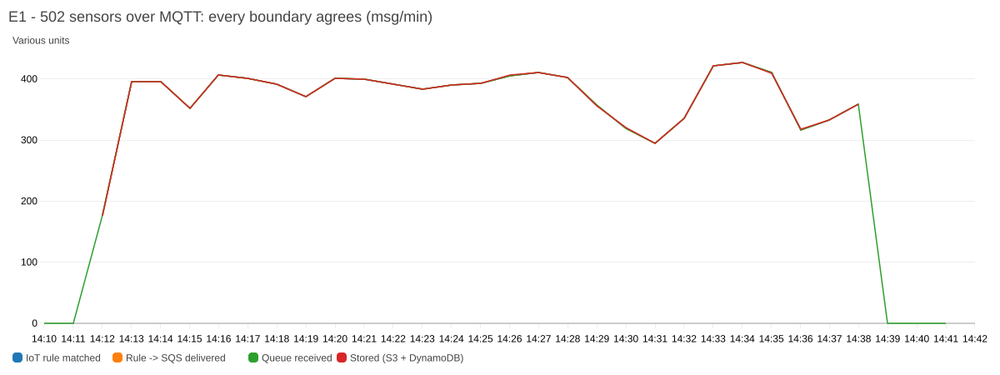
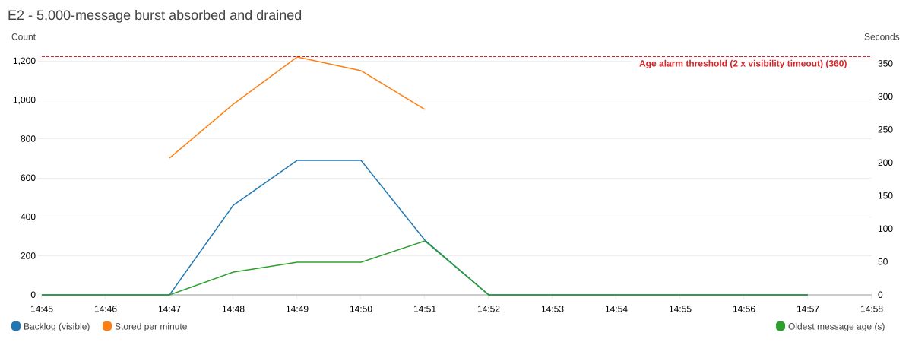
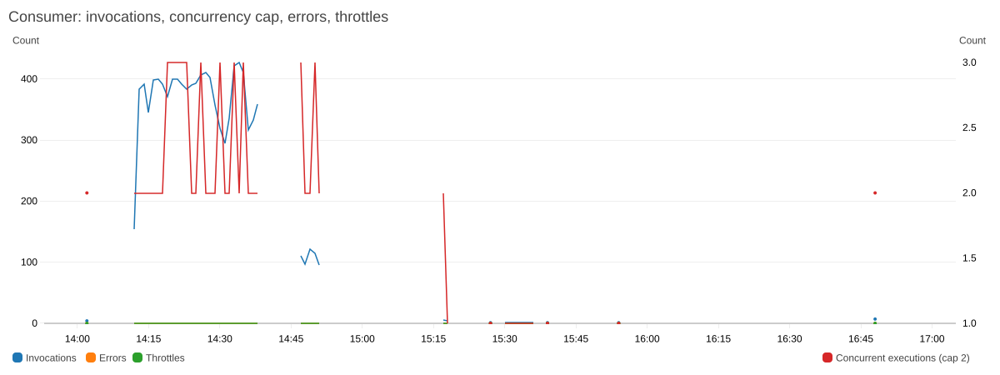
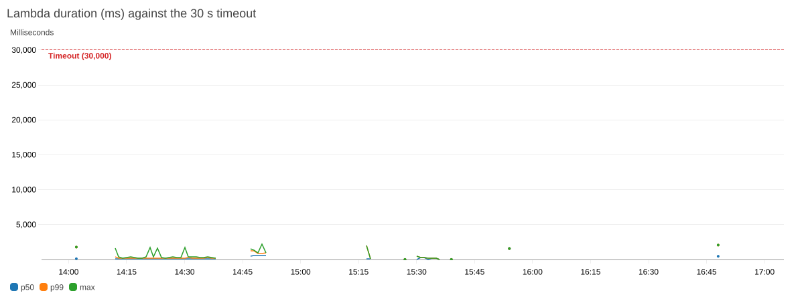
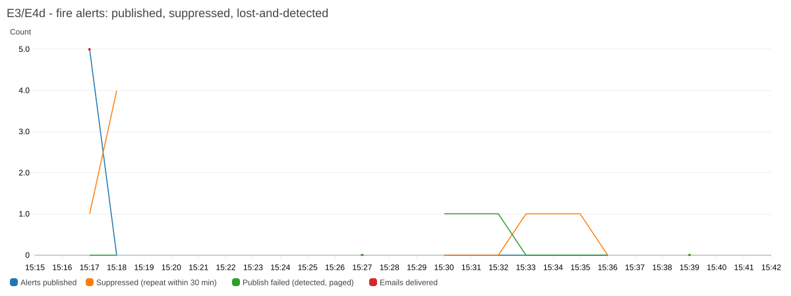
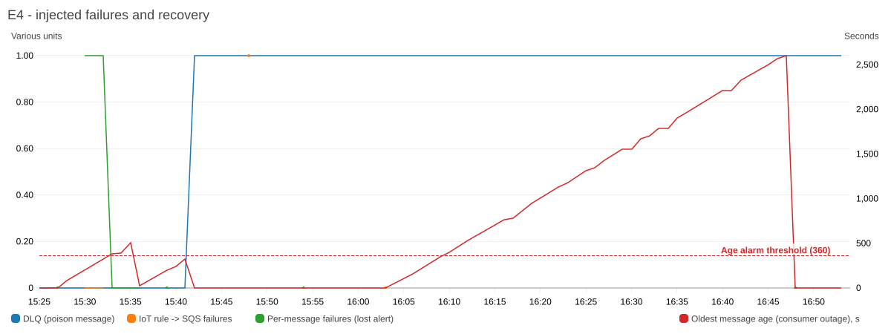
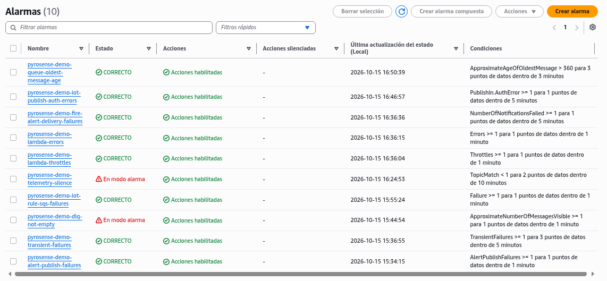

# PyroSense v1.0 — Evidence run 2026-10-15

- **Commit:** 981aae6 · **Region:** us-east-1 · **Environment:** demo (ephemeral; created, tested and destroyed in one session)
- **Deploy from nothing:** 50 resources in 105 s · **Quality gate:** 95 tests passed, coverage 99%, Trivy/TFLint/gitleaks clean
- **Messages processed:** 15110 stored · **Lost:** 0 (see raw/ledger.txt)
- **Cost of this run:** ≈ USD 0.004

## Results

| ID | Test | What it proves | Observed | Result |
|---|---|---|---|---|
| Q | Quality gate on this commit | Code, IaC and security checks pass before deploy | logs/quality-gate.txt | PASS |
| E1 | 502 sensors x 20 rounds over MQTT + X.509 mutual TLS | Real device path at scale, zero loss | 10040 acknowledged, 0 missing; 6.34 msg/s (59 % of the 10.7 msg/s production model); device-to-archive latency p50 0.6 s, p95 1.06 s, max 2.71 s (1 s resolution) | PASS |
| E2 | 5,000-message burst straight into the queue | Buffer absorbs a reconnect storm; consumer drains with zero loss | 5000 archived in 273 s (18.3 msg/s), 0 errors, 0 throttles, DLQ 0; configured maximum concurrency 2, Lambda ConcurrentExecutions (1-min maximum) reached 3 in 11 minutes across E1b and E2 (raw/e2-concurrency-above-cap.txt) | PASS |
| E3 | 5 sensors report CRITICAL smoke, twice | One alert per sensor within seconds; repeats suppressed | 5 alerts, reading-to-alert-published p50 1.18 s, max 2.81 s; 5 repeats suppressed; 5 emails received | PASS |
| E4a | Contract-violating payload | Retried 5 times, isolated in the DLQ, operator paged | DLQ 1, InvalidPayloads 5, dlq-not-empty ALARM + email (raw/e4-checks.txt) | PASS |
| E4b | Consumer disabled | Backlog held, operator paged, zero loss on recovery | 50 queued; oldest message reached 1427 s; queue-age alarm + email; the re-enable step did not take effect and the drift check (E7) found the consumer still disabled; re-enabled after ~46 min in total; all 50 stored, alarm back to OK | PASS |
| E4c | IoT rule loses permission to write to the queue | Failure paged; message recovered byte-for-byte from the error log | 1 rule failure, alarm + email, replay IDENTICAL and stored (raw/e4-checks.txt) | PASS |
| E4d | Fire-alert publish denied | A lost alert is detected, logged with the sensor ID, and paged | 3 publish failures, 2 alarms + emails, 3 CRITICAL log lines naming each sensor | PASS (loss detected, not prevented: by design in v1.0) |
| E5 | Attacks outside the allowed path | Edge and transport controls hold | Cross-environment publish denied; foreign client ID refused; plain-HTTP queue access denied; 9/9 stores encrypted with the pipeline key (rotation on); consumer policy 9 statements, 0 wildcards, 0 Access Analyzer errors or security warnings; 0 private keys in Terraform state | PASS |
| E6 | Alarm action paths | Every alarm can reach the operator | 10/10 alarms executed their SNS action (7 by real faults, 3 by set-alarm-state) | PASS |
| E7 | Drift check after all tests | Deployed system equals the code | first check found drift: event source mapping left disabled after E4b; re-enabled; final terraform plan exit 0 | PASS |
| L | Ledger | What went in equals what came out | raw/ledger.txt | PASS |

## Charts

Alarm list at the end of the run: 8 OK; dlq-not-empty in ALARM because the E4a poison message is held in the DLQ for triage (never redriven blindly); telemetry-silence in ALARM because the fleet stopped publishing after the tests. Both are the designed behaviour.

## Method notes

- E2 sends directly to the queue with an administrator identity: it isolates the buffer and the consumer; E1 covers the device edge.
- Latency is measured from the device send time (publisher clock, NTP-synchronized) to the first durable write (S3, whole-second timestamps) or to the "alert published" log line. Email delivery after publish is outside what the CLI can measure.
- Three alarms (Lambda errors, Lambda throttles, SNS delivery failures) have no safe real trigger in a demo; set-alarm-state proves their action path only.
- All temporary fault injections were reverted; the drift check caught the one that was not, and the final plan showed no drift.
