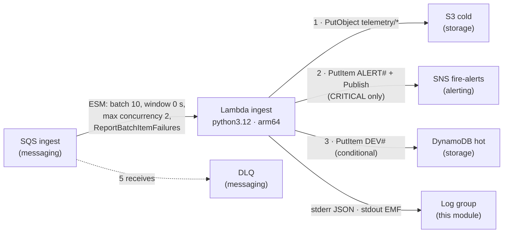

# modules/ingest

The consumer of the pipeline: an SQS-triggered Lambda that validates each
telemetry message against contract v1, classifies fire risk, archives the raw
body in S3, publishes a suppressed alert on CRITICAL risk, and commits the hot
item with a conditional write that is also the deduplication guard.

**Status:** deployed and verified end to end in demo (2026-10-07). See
[Verified at runtime](#verified-at-runtime-2026-10-07-demo) and
[Not verified yet](#not-verified-yet).

---

## Architecture



Order inside the function is load-bearing (ADR-0008): the dedup commit goes
last, so any failure before it leaves no hot item behind and the retry repeats
the whole message safely.

**Who does what on a failure (unchanged from `modules/messaging`, ADR-0011).**
The handler decides *which* messages failed and reports them in
`batchItemFailures`. The queue decides *when* to retry them (they reappear after
the 180 s visibility timeout) and *when* to give up (after 5 receives, to the
DLQ). Lambda's asynchronous-invocation retries and function-level DLQ belong to
a different invocation model and are not configured.

---

## Resources

| Address | Purpose |
|---|---|
| `data.archive_file.ingest` | Zips `src/ingest_lambda` (zip root = the directory) into `lambda_build/`, excluding bytecode, with pinned file modes |
| `aws_cloudwatch_log_group.ingest` | `/aws/lambda/<name_prefix>-ingest`, 14-day retention, CMK, `STANDARD` class |
| `aws_iam_role.ingest` | Execution role, trusted by `lambda.amazonaws.com` only |
| `aws_iam_role_policy.ingest` | Inline least-privilege policy (contract below) |
| `aws_lambda_function.ingest` | The function; env vars encrypted with the CMK; `Text` log format |
| `aws_lambda_event_source_mapping.sqs` | SQS → Lambda, partial batch responses, concurrency cap |

5 managed resources + 3 data sources (`archive_file`, two `aws_iam_policy_document`)
+ `aws_region`. No resource-level tags (ADR-0004).

---

## Design decisions (ADR-0019)

| # | Decision | Why |
|---|---|---|
| D1 | `python3.12`, `arm64`, zip from the source directory, boto3 from the runtime | The runtime the tests and mypy prove (`pyproject.toml`); pure-Python code is architecture agnostic and arm64 is cheaper per GB-second; ADR-0007 keeps the artifact dependency-free. AWS recommends bundling the SDK: that tension is recorded in the ADR |
| D2 | Every variable `config.py` reads is injected explicitly; design constants are module locals; detection policy is a required input | Terraform is the single source of the config contract; no default in code can silently diverge from a dashboard or a test |
| D3 | Unreserved concurrency; event-source `maximum_concurrency = 2` | Reserving in a single-function account buys nothing and can be refused by a new account's quota; the ESM cap is the real brake on cost and load |
| D4 | No X-Ray tracing | Without an SDK, a trace shows only Lambda's own segments; enabling it needs the project's only `Resource "*"` grant |
| D5 | KMS scoping (`kms:ViaService`, encryption context) applied in a second step | One unknown per runtime test: the basic path must pass before the scoping conditions are added |
| D6 | `HOT_RETENTION_DAYS` derived from messaging's two retentions + 1 day (= 19) | A redriven duplicate can be up to DLQ retention old, then wait the source retention again; the hot item must outlive it or dedup breaks |

---

Detection policy (thresholds and suppression window) is not this module's
decision: values and ownership are ADR-0020. The module only validates them.

## Inputs

| Name | Type | Validation | Source in the root |
|---|---|---|---|
| `name_prefix` | string | `^[a-z0-9-]{1,64}$`; derived names checked ≤ 64 | `local.name_prefix` |
| `environment` | string | `demo` \| `prod` | `var.environment` |
| `source_dir` | string | contains `handler.py` and `config.py` | `"${path.root}/src/ingest_lambda"` |
| `kms_key_arn` | string | key ARN regex (same literal as alerting, debt #21) | `module.security.kms_key_arn` |
| `permissions_boundary_arn` | `string` | IAM managed policy ARN (`arn:aws…:iam::<12 digits>:policy/…`); required, no default | `data.aws_iam_policy.workload_boundary.arn` (policy created by `bootstrap/ci-identity`, ADR-0023) |
| `queue_arn` | string | — | `module.messaging.queue_arn` |
| `queue_message_retention_seconds` | number | > 0 | `module.messaging.message_retention_seconds` (new) |
| `dlq_message_retention_seconds` | number | > 0 | `module.messaging.dlq_message_retention_seconds` (new) |
| `table_name` | string | — | `module.storage.table_name` |
| `table_arn` | string | — | `module.storage.table_arn` |
| `bucket_id` | string | — | `module.storage.bucket_id` |
| `bucket_arn` | string | — | `module.storage.bucket_arn` |
| `telemetry_objects_arn` | string | — | `module.storage.telemetry_objects_arn` |
| `fire_alerts_topic_arn` | string | — | `module.alerting.fire_alerts_topic_arn` |
| `timeout_seconds` | number | integer 1–900 | `local.ingest_lambda_timeout_seconds` |
| `batching_window_seconds` | number | integer 0–300 | `local.ingest_batching_window_seconds` |
| `smoke_alert_ppm` | number | > 0 | root local (ADR-0020) |
| `temp_alert_c` | number | within contract range [-20, 80] | root local (ADR-0020) |
| `rh_alert_pct` | number | within contract range [0, 100] | root local (ADR-0020) |
| `alert_suppression_minutes` | number | integer 1–1440 (slot TTL is 1 day, debt #15) | root local (ADR-0020) |

## Outputs

| Name | Consumer |
|---|---|
| `function_name` | root re-export (CLI `--function-name`), observability (`FunctionName` dimension) |
| `function_arn` | review against the ESM and CloudTrail |
| `role_arn` | runtime proof: CloudTrail `userIdentity` of KMS/DynamoDB/S3/SNS calls |
| `log_group_name` | root re-export (CLI `--log-group-name`), observability |
| `event_source_mapping_uuid` | root re-export (CLI `--uuid`), observability |
| `metrics_namespace` | observability (EMF metrics) |
| `hot_retention_days` | review: the value the dedup guarantee rests on |

---

## Contract with `config.py` (develop, 2026-10-06)

| Variable | Required in code | Code default | Injected value | Source | ✓ |
|---|---|---|---|---|---|
| `ENVIRONMENT` | yes | — | `demo` / `prod` | `var.environment` | ✓ |
| `TABLE_NAME` | yes | — | table name | storage | ✓ |
| `BUCKET_NAME` | yes | — | bucket name | storage `bucket_id` | ✓ |
| `ALERT_TOPIC_ARN` | yes | — | fire topic ARN | alerting | ✓ |
| `SMOKE_ALERT_PPM` | yes (float) | — | `tostring(var.smoke_alert_ppm)` | root local (ADR-0020) | ✓ |
| `TEMP_ALERT_C` | yes (float) | — | `tostring(var.temp_alert_c)` | root local (ADR-0020) | ✓ |
| `RH_ALERT_PCT` | yes (float) | — | `tostring(var.rh_alert_pct)` | root local (ADR-0020) | ✓ |
| `HOT_RETENTION_DAYS` | yes (int) | — | `19` (derived) | messaging outputs | ✓ |
| `ALERT_SUPPRESSION_MINUTES` | yes (int) | — | `tostring(var.alert_suppression_minutes)` | root local (ADR-0020) | ✓ |
| `METRICS_NAMESPACE` | no | `PyroSense/Ingest` | `PyroSense/Ingest` | module local | ✓ |
| `LOG_LEVEL` | no | `INFO` | `INFO` | module local | ✓ |

Eleven read, eleven injected, none empty (a plan-time precondition enforces it:
`config.py` does not fall back to the default for `""`, debt #25). HCL cannot
express `inf` or `nan`, so the non-finite case of debt #23 cannot come from
Terraform; the range validations on the inputs cover what `config.py` still
accepts (debts #15, #23, #24) until `fix/config-validation` merges.

---

## IAM contract (execution role)

| Sid | Actions | Resource | Conditions (step 2) | Source contract |
|---|---|---|---|---|
| `WriteOwnLogStreams` | `logs:CreateLogStream`, `logs:PutLogEvents` | `<log_group_arn>:*` | — | standard #6 |
| `ConsumeIngestQueue` | `sqs:ReceiveMessage`, `sqs:DeleteMessage`, `sqs:GetQueueAttributes` | `queue_arn` | — | messaging |
| `DecryptIngestQueue` | `kms:Decrypt` | `kms_key_arn` | `kms:ViaService = sqs.<region>.amazonaws.com` | messaging |
| `WriteHotStore` | `dynamodb:PutItem` | `table_arn` | — | storage |
| `DecryptHotStoreTableKey` | `kms:Decrypt` | `kms_key_arn` | `kms:ViaService = dynamodb.<region>…`, `kms:EncryptionContext:aws:dynamodb:tableName = table_name` | storage |
| `WriteColdStore` | `s3:PutObject` | `telemetry_objects_arn` | — | storage |
| `EncryptColdStoreObjects` | `kms:GenerateDataKey` | `kms_key_arn` | `kms:ViaService = s3.<region>…`, `kms:EncryptionContext:aws:s3:arn = bucket_arn` | storage |
| `PublishFireAlerts` | `sns:Publish` | `fire_alerts_topic_arn` | — | alerting |
| `EncryptFireAlerts` | `kms:GenerateDataKey*`, `kms:Decrypt` | `kms_key_arn` | `kms:ViaService = sns.<region>…` | alerting |

Not granted, on purpose: `logs:CreateLogGroup` (a Lambda-created group has no
retention and no CMK), `kms:DescribeKey` (DynamoDB uses it when a key is chosen
for a table, not on item writes; debt #19), `kms:Decrypt` for S3 (needed only
for multipart uploads; `cold_store.py` uses a single `PutObject`),
`sqs:ChangeMessageVisibility` (absent from AWS's own SQS-consumer policy), any
X-Ray action, any managed policy. No change to the key policy: every call
above goes through `EnableIAMDelegation` with the role's own permissions; the
log group uses the existing `AllowCloudWatchLogs` statement.

Environment variables are encrypted with the CMK. At runtime each new execution
environment calls `kms:Decrypt` **as the execution role**, with encryption
context `aws:lambda:FunctionArn`, and succeeds although no IAM statement allows
it: the authorization is the grant Lambda creates on the key with the
deployer's `kms:CreateGrant` (see Verified at runtime). No IAM statement is
needed for it.

---

## Cost

Prices: us-east-1, verified 2026-10-06. Free-tier lines may not apply to an
account on the credit-based Free plan.

**Demo (smoke + one 1-hour `load_test`, ~37,000 messages):** S3 PUTs ≈ $0.18,
DynamoDB writes ≈ $0.02, Lambda, logs and metrics within free tiers or cents.
Under $0.25 per cycle, on top of the CMK's $1/month (modules/security).

**Production (~27.7 M messages/month, ADR-0002).** Two unknowns drive it: the
average batch size `b` (with a 0 s window, batches are as large as whatever is
waiting) and the per-message duration (debt #11). Shown for `b = 1` (worst) and
100 ms per message (placeholder, to be replaced with measured Duration).

| Item | Model | $/month |
|---|---|---|
| S3 PUT (one object per message) | 27.7 M × $0.005 / 1,000 | **138.50** |
| DynamoDB writes (on-demand) | 27.7 M WRU × $0.625 / M (assumes item ≤ 1 KB) | 17.31 |
| DynamoDB storage + PITR | ~17.5 M live items (19-day TTL) × ~0.5 KB ≈ 8.8 GB | ≈ 2.19 + 1.75 |
| Lambda requests | 27.7 M / b invocations × $0.20 / M (1 M free) | 5.34 (b = 1) · 0.91 (b = 5) |
| Lambda duration (arm64, 256 MB) | 27.7 M × 0.1 s × 0.25 GB = 692,500 GB-s × $0.0000133334 | 3.90 after free tier · 9.23 without |
| CloudWatch Logs ingestion | ~0.7 KB per invocation (platform lines + 1 EMF line) | 7.20 (b = 1) · ~0 (b = 5) |
| EMF custom metrics | 5 metrics × 1 dimension value (`Environment`) | 1.50 (or free tier) |
| SQS requests (debt #10) | ≥ send 27.7 M + receive and delete 27.7 M / b each, + empty polls | **not priced** (per-million rate not rendered on the pricing page) |
| KMS requests | per principal per 5 min (SQS, DynamoDB), Bucket Key for S3 | cents |

**S3 PUTs are ~75 % of the known cost.** One object per message is ADR-0013's
flat archive; compaction (debt #18) is the lever, not this module.

EMF cardinality: `metrics.py` emits one dimension set, `[["Environment"]]`, so a
615-device `load_test` still produces 5 metrics per environment. No per-device
dimension.

---

## Failure modes an operator must know

| Fails | What happens | Signal today |
|---|---|---|
| `s3:PutObject` (IAM, KMS, outage) | Exception → item failure → retry every 180 s → DLQ after 5 | Function logs (`message_id` only), DLQ depth (alarm: observability) |
| `sns:Publish` (IAM, KMS, throttle) | Slot already claimed → retry finds the window closed → `AlertsSuppressed` → hot item committed → **alert lost** (ADR-0005, debt #26) | **None**: metrics look healthy. Python change proposed (see `PYTHON-PROPOSALS-ingest.md`) |
| Contract violation | `InvalidPayloads` +1 per attempt (×5), then DLQ (ADR-0012) | EMF + DLQ depth |
| Throttling (concurrency) | Lambda backs off; message returns after the visibility timeout. Whether that consumes a receive (→ DLQ) is not stated by the docs | `Throttles` (observability) |
| SQS decrypt (KMS) | The event source cannot receive; the function is never invoked | **No function log at all**: queue age and ESM state only |

---

## Verification

### Static (from the root)

```bash
terraform init -backend-config=config/backend.hcl   # adds the archive provider; commit .terraform.lock.hcl
terraform fmt -check -recursive
terraform validate
tflint --recursive
trivy config . --tf-vars demo.tfvars   # read the log; confirm the printed IDs match AVD-AWS-0057 / AVD-AWS-0066
make check && pre-commit run --all-files
```

### Plan

No `-target`: under `-target` Terraform keeps a root output only if it
descends from a targeted resource, so the constant `ingest_metrics_namespace`
would be dropped from the plan and the state (`transform_targets.go`). The E2E
runtime (`RUNBOOK-ingest.md`) deploys every module anyway.

```bash
terraform plan -var-file=demo.tfvars -out=tfplan
terraform show -json tfplan > tfplan.json   # contains sensitive values in clear text: never commit

# Exactly 5 managed resources in this module
jq -r '[.resource_changes[] | select(.module_address=="module.ingest" and .mode=="managed") | .address] | sort[]' tfplan.json

# Function settings. The environment map is entirely unknown at plan time
# (SDKv2 cannot plan a partly known map), so its 11 keys are checked after
# apply: aws lambda get-function-configuration --query Environment.Variables
jq '.resource_changes[] | select(.address=="module.ingest.aws_lambda_function.ingest") | .change.after
    | {runtime, architectures, handler, timeout, memory_size, log_format: .logging_config[0].log_format}' tfplan.json

# Event source
jq '.resource_changes[] | select(.address=="module.ingest.aws_lambda_event_source_mapping.sqs") | .change.after
    | {batch_size, maximum_batching_window_in_seconds, function_response_types, scaling_config, filter_criteria}' tfplan.json

# Zip contents: only top-level .py files, no __pycache__
unzip -l lambda_build/pyrosense-demo-ingest.zip
```

### Runtime

See the DoD in the FASE A delivery: account settings first, basic path with the
STEP 2 conditions removed, then the scoped policy, CloudTrail identity checks.

---

## Verified at runtime (2026-10-07, demo)

Full pipeline through IoT Core with the smoke publisher, `RUNBOOK-ingest.md`.
The scoped policy (all six `STEP 2` conditions) was applied directly; the
unscoped R1 step was not needed.

- T1–T6 passed: storage in S3 and DynamoDB, CRITICAL alerts by email with
  suppression, dedup of a duplicate delivery, contract violations to the DLQ
  after 5 attempts, partial batch responses, silent IoT rule error log.
- KMS calls made as the execution role, all with `errorCode: null` (CloudTrail):

  | Call | Via | Encryption context | Statement |
  |---|---|---|---|
  | `Decrypt` | SQS | `aws:sqs:arn` = ingest queue | `DecryptIngestQueue` |
  | `Decrypt` | DynamoDB | `aws:dynamodb:tableName` = hot table, `aws:dynamodb:subscriberId` | `DecryptHotStoreTableKey` |
  | `GenerateDataKey` only (no `Decrypt`, with Bucket Key) | S3 (`fas.s3.amazonaws.com`) | `aws:s3:arn` = **bucket** ARN | `EncryptColdStoreObjects` |
  | `GenerateDataKey` + `Decrypt` | SNS | `aws:sns:topicArn` = fire topic | `EncryptFireAlerts` |
  | `Decrypt` | Lambda infrastructure (public IPs) | `aws:lambda:FunctionArn` = this function | none: authorized by the Lambda grant |

  Debt #19 is closed: the actions and contexts behind every KMS statement and
  condition match what the services send. No `kms:DescribeKey` call appeared.
- Trivy reported no finding on `modules/ingest` in the static gate.

Pending evidence: `aws kms list-grants` output showing the Lambda grant
(grantee = execution role, `Decrypt`, constraint on `aws:lambda:FunctionArn`).
The runtime result already proves IAM is not what authorizes those calls.

## Not verified yet

- Whether a throttled SQS invocation consumes a receive count.
- EMF extraction on the `INFREQUENT_ACCESS` log class (kept `STANDARD`).
- The DynamoDB TLS-only resource policy (debt #48): if it is merged before the
  next cycle, the runtime proves the role still writes over HTTPS.
- End-to-end with the real simulator (debts #47, #49) and all alarms
  (observability).
- Measured `Duration` (debt #11): read it from this cycle's CloudWatch data
  before tuning memory, timeout or concurrency.
