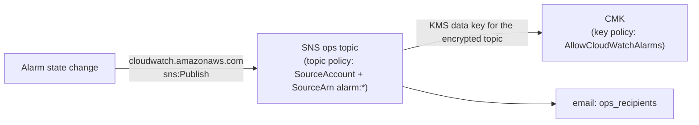

# modules/observability

CloudWatch alarms, two log metric filters and one dashboard. Together they
answer, for every boundary of the PyroSense pipeline, "who finds out if this
fails?". Every alarm notifies the KMS-encrypted ops topic of `modules/alerting`
on `ALARM` and on `OK`.

Design decisions: [ADR-0021](../../docs/adr/ADR-0021-observability-signal-policy.md).

## What it creates

| Address | What | Why |
|---|---|---|
| `aws_cloudwatch_metric_alarm.this["<key>"]` ×10 | One alarm per signal (catalogue below) | Each fault pages once, at the layer where it first becomes visible (ADR-0021 D1) |
| `aws_cloudwatch_log_metric_filter.transient_failures` | `{ $.message = "Processing failed*" }` on the ingest log group → `TransientFailures` | `handler.py` swallows per-message exceptions, so Lambda `Errors` never sees them |
| `aws_cloudwatch_log_metric_filter.rule_error_documents` | `{ $.ruleName = "<rule>" }` on the IoT rule error log group → `RuleErrorDocuments` | Dashboard cross-check: `Failure − RuleErrorDocuments` = payloads lost without trace |
| `aws_cloudwatch_dashboard.pipeline` | `<name_prefix>-pipeline` | Both sides of every boundary, in data-flow order |

It creates no IAM, no KMS key, no log group and no data store.

## Alarm catalogue

All alarms are named `<name_prefix>-<key>`, have `actions_enabled = true` (demo
included) and send `alarm_actions` and `ok_actions` to `ops_topic_arn`.

| Key | Metric (namespace) | Stat | Condition | Period × eval (M of N) | Missing data | Fault it detects | How it was verified (2026-10-14) |
|---|---|---|---|---|---|---|---|
| `telemetry-silence` | `TopicMatch` (`AWS/IoT`, `RuleName`) | Sum | `< 1` | 300 s × silence/5 (all) | **breaching** | Fleet silent: sensors down, certificate revoked, publisher stopped, rule disabled | Real path: no telemetry for `telemetry_silence_minutes`; recovers on the next message |
| `iot-publish-auth-errors` | `PublishIn.AuthError` (`AWS/IoT`, `Protocol=MQTT`) | Sum | `≥ 1` | 300 s × 1 | notBreaching | Publishes denied at the edge (lost telemetry, or probing). Account-wide | Real path: MQTT publish with the fleet certificate to a topic outside the IoT policy |
| `iot-rule-sqs-failures` | `Failure` (`AWS/IoT`, `RuleName`, `ActionType=SQS`) | Sum | `≥ 1` | 60 s × 1 | notBreaching | Rule could not write to the queue; payload only in the error log | Real path: forwarding role policy temporarily removed, then restored by Terraform |
| `queue-oldest-message-age` | `ApproximateAgeOfOldestMessage` (`AWS/SQS`, ingest queue) | Maximum | `> 2 × VT` (360 s in demo) | 60 s × 3 (3 of 3) | notBreaching | Queue not drained: ESM disabled or unable to decrypt, saturation | Real path: event source mapping temporarily disabled, then re-enabled (no drift left) |
| `dlq-not-empty` | `ApproximateNumberOfMessagesVisible` (`AWS/SQS`, DLQ) | Maximum | `≥ 1` | 60 s × 1 | **ignore** | A message exhausted its 5 receives (contract violation or persistent dependency failure) | Real path: a contract-violating payload retried 5 times and moved to the DLQ (debt #31) |
| `lambda-errors` | `Errors` (`AWS/Lambda`) | Sum | `≥ 1` | 60 s × 1 | notBreaching | Invocation failed: config error at cold start, timeout, OOM, exception outside the per-message loop | `set-alarm-state`: proves the action path, not the condition |
| `lambda-throttles` | `Throttles` (`AWS/Lambda`) | Sum | `≥ 1` | 60 s × 1 | notBreaching | Account concurrency exhausted (the ESM caps itself at 2) | `set-alarm-state` |
| `transient-failures` | `TransientFailures` (`PyroSense/LogSignals/<env>`) | Sum | `≥ 1` | 60 s × 5 (3 of 5) | notBreaching | Per-message S3 / DynamoDB / SNS / KMS / IAM failures | Real path: one failing message per minute for 5 minutes (same injection as `alert-publish-failures`) |
| `alert-publish-failures` | `AlertPublishFailures` (`PyroSense/Ingest`, `Environment`) | Sum | `≥ 1` | 60 s × 1 | notBreaching | A fire alert was lost (ADR-0005, ADR-0015 D2) | Real path: temporary Deny on the fire topic policy for the ingest role, then restored, with CRITICAL payloads |
| `fire-alert-delivery-failures` | `NumberOfNotificationsFailed` (`AWS/SNS`, fire topic) | Sum | `≥ 1` | 300 s × 1 | notBreaching | SNS gave up delivering an alert | `set-alarm-state` |

Why each `treat_missing_data`:

- **notBreaching.** Lambda, IoT and SNS failure counters emit nothing while
  nothing happens, so absence means healthy.
- **breaching.** Absence is the fault. This applies only to the heartbeat.
- **ignore.** SQS stops emitting metrics for a queue that nothing touches for
  six hours, *even if it holds messages*. With `notBreaching` the DLQ alarm
  would clear while the evidence is still inside.

### Not alarmed (dashboard only)

| Signal | Why no alarm |
|---|---|
| `InvalidPayloads` | Counts attempts (×5 per message). The DLQ alarm pages once per broken message (debt #9). |
| `Connect.AuthError` | A fleet that cannot connect pages through `telemetry-silence`. Other connect failures are not actionable. |
| `RuleErrorDocuments` | Same event as `iot-rule-sqs-failures`, and it depends on the error action working. |
| Lambda `Duration` | Max 1715 ms against a 30 s timeout (2026-10-07). A timeout already pages via `lambda-errors` (ADR-0021 D5). |
| DynamoDB `ThrottledRequests` / `SystemErrors` | A failed `PutItem` surfaces as `transient-failures`. CloudWatch also always ignores missing data on `AWS/DynamoDB` alarms. |
| `ConditionalCheckFailedRequests` | Produced on purpose by dedup (ADR-0008) and suppression (ADR-0005). |
| ESM `metrics_config` (`EventCount`) | Not enabled: it would modify `modules/ingest`, and queue age covers "ESM not consuming". |

## Inputs

| Name | Type | Source in the root | Validation |
|---|---|---|---|
| `name_prefix` | string | `local.name_prefix` | `^[a-z0-9-]{1,64}$` |
| `environment` | string | `var.environment` | `demo` \| `prod` |
| `queue_name` | string | `module.messaging.queue_name` | non-empty |
| `dlq_name` | string | `module.messaging.dlq_name` | non-empty |
| `queue_visibility_timeout_seconds` | number | `module.messaging.visibility_timeout_seconds` (**new output**) | integer 1–43200 |
| `function_name` | string | `module.ingest.function_name` | non-empty |
| `function_timeout_seconds` | number | `local.ingest_lambda_timeout_seconds` | 1–900 |
| `ingest_log_group_name` | string | `module.ingest.log_group_name` | non-empty |
| `metrics_namespace` | string | `module.ingest.metrics_namespace` | non-empty |
| `topic_rule_name` | string | `module.iot.topic_rule_name` | `^[a-zA-Z0-9_]{1,128}$` |
| `rule_error_log_group_name` | string | `module.iot.rule_error_log_group_name` | non-empty |
| `fire_alerts_topic_name` | string | `module.alerting.fire_alerts_topic_name` | non-empty |
| `ops_topic_arn` | string | `module.alerting.ops_topic_arn` | standard SNS topic ARN |
| `telemetry_silence_minutes` | number | root `local` (policy, ADR-0021 D2; provisional 10) | multiple of 5, 5–1440 |

There is no `kms_key_arn` input. The alarms reach the encrypted topic as a
service principal, authorized by the key policy and the topic policy. This
module encrypts nothing of its own (debt #22).

Derived inside the module:

- **Queue-age threshold** = 2 × VT. A transiently failing message is received
  at most three times before SQS drops it from the age metric, so a healthy
  queue stays under two visibility timeouts.
- **Silence evaluation periods** = `telemetry_silence_minutes / 5`.
- **Log-metric namespace** = `PyroSense/LogSignals/<environment>`. A metric
  filter cannot add a constant dimension, so the environment goes in the
  namespace.

## Outputs

| Output | Consumer |
|---|---|
| `alarm_name_prefix` | `aws cloudwatch describe-alarms --alarm-name-prefix`, destroy check |
| `alarm_names` | Map key → name for `describe-alarm-history` / `set-alarm-state --alarm-name` |
| `dashboard_name` | `aws cloudwatch get-dashboard --dashboard-name` |
| `log_metrics_namespace` | `get-metric-statistics --namespace` for the log-derived metrics |

## Contracts this module depends on

| Contract | Owner | Breaks how |
|---|---|---|
| Log message prefix `Processing failed` (JSON field `message`) | `src/ingest_lambda/handler.py` (`TRANSIENT_FAILURE_LOG_PREFIX`) | `transient-failures` goes permanently quiet. Pinned by `tests/test_alert_publish_observability.py`. |
| EMF counter `AlertPublishFailures`, dimension `Environment`, emitted on every invocation | `src/ingest_lambda/handler.py` and `alerts.py` (`AlertPublishError`) | `alert-publish-failures` never fires. Pinned by the same test file (the six EMF metric names). |
| Error-document field `ruleName` | AWS IoT (documented format) | `RuleErrorDocuments` stays at 0. |
| `ActionType=SQS` dimension value | AWS IoT (observed at runtime 2026-10-06; not enumerated in the docs) | `iot-rule-sqs-failures` watches a series that never exists. Confirmed at runtime: the alarm fired on a real rule failure. |
| Key policy `AllowCloudWatchAlarms` | `modules/security` | Every alarm action fails. Visible only in `describe-alarm-history`. |
| Topic policy `AllowCloudWatchAlarms` (ops) | `modules/alerting` | Same. |

## IAM / KMS

Nothing is granted here. The path an alarm action takes:



Both statements were exercised for the first time by this module's alarms
(debt #31). After that first proof, the key policy statement was hardened from
`StringEqualsIfExists aws:SourceAccount` to `StringEquals aws:SourceAccount` +
`ArnLike aws:SourceArn` on alarm ARNs, and the action path was proven again
(debt #30; `modules/security`, ADR-0010).

## Cost (us-east-1)

| Item | Unit price | Demo (cycle ≈ 1 day) | Prod (month) |
|---|---|---|---|
| 10 standard alarms | $0.10 per alarm metric-month [V pricing examples] | ≈ $0.03 [I: prorated], $0 inside the 10-alarm free tier | $1.00 |
| 2 metric-filter metrics + `AlertPublishFailures` | $0.30 per custom metric-month (first 10,000) [V] | ≈ $0.03 [I] | $0.90 |
| Dashboard | 3 free per month [V]; paid price not rendered [?] | $0 | $0 (1 dashboard) |
| Alarm emails | SNS email: 1,000 free per month [V, alerting] | $0 | $0 |
| Metric filter evaluation | No charge rendered on the pricing page [?] | — | — |

Total ≈ **$1.90/month in prod**, independent of traffic. The module adds no log
ingestion: the filters read lines the function already writes.

## Verification

### Static (from the root)

`terraform fmt -check -recursive`, `terraform validate`, `tflint --recursive`,
`trivy config . --tf-vars demo.tfvars` (read the log).

### Plan (`jq` over `terraform show -json tfplan`)

```bash
jq -r '[.resource_changes[] | select(.module_address=="module.observability" and .mode=="managed") | .address] | sort[]' tfplan.json
# Expected: 13 addresses — the dashboard, 2 metric filters, 10 alarms keyed:
# alert-publish-failures, dlq-not-empty, fire-alert-delivery-failures,
# iot-publish-auth-errors, iot-rule-sqs-failures, lambda-errors,
# lambda-throttles, queue-oldest-message-age, telemetry-silence, transient-failures

jq '.resource_changes[] | select(.module_address=="module.observability" and .type=="aws_cloudwatch_metric_alarm") | {k: .index, ns: .change.after.namespace, m: .change.after.metric_name, d: .change.after.dimensions, s: .change.after.statistic, t: .change.after.threshold, op: .change.after.comparison_operator, tmd: .change.after.treat_missing_data, actions_unknown: .change.after_unknown.alarm_actions}' tfplan.json
# Expected: values as in the catalogue; dimensions carry the real names
# (pyrosense-demo-ingest, pyrosense_demo_telemetry_to_sqs, ...);
# alarm_actions unknown (true) because the ops topic is created in the same plan.
```

### Runtime

Verified end to end in a demo deploy/destroy cycle on 2026-10-14, with the
fleet publisher over MQTT and `aws iot-data publish` for controlled payloads.
Each alarm was driven through its real failure path where one exists without
clickops (see the catalogue). Temporary changes to deployed resources were
reverted, and a plan afterwards showed no drift. `lambda-errors`,
`lambda-throttles` and `fire-alert-delivery-failures` have no safe real
trigger; for them `set-alarm-state` proves the action path, not the condition.

### Behaviour observed at runtime

| Observation | Consequence |
|---|---|
| The nine alarms that need no data change state within ~90 s of creation: eight to `OK`, `telemetry-silence` straight to `ALARM` (missing periods before the alarm existed count as breaching) | A fresh deploy sends ~9 emails before anyone can confirm a subscription; they are lost if subscriptions are still pending. `describe-alarm-history` keeps the evidence. In production subscriptions persist, so this only affects the first deploy. |
| `ok_actions` also fire on `INSUFFICIENT_DATA → OK`, not only on `ALARM → OK` | Every new alarm sends an OK email when it settles. |
| A newly created DLQ reports `0` within minutes | `dlq-not-empty` (`ignore`) leaves `INSUFFICIENT_DATA` for `OK` on its own. |
| Event-count alarms (`iot-publish-auth-errors`, `iot-rule-sqs-failures`, …) return to `OK` one empty period after the last event (5–10 min for 300 s periods) | An isolated event produces an ALARM email and an OK email; a sustained fault keeps one ALARM. |
| An email subscription confirmed by clicking the link is not authenticated (`ConfirmationWasAuthenticated = false`) | Anyone holding a forwarded alarm email can unsubscribe the endpoint. Confirm with `aws sns confirm-subscription --authenticate-on-unsubscribe true`. |

## Known risks and what is not verified

| # | Item | Status |
|---|---|---|
| 1 | Metric filters on a log group encrypted with a CMK | Verified 2026-10-14: `TransientFailures` (ingest log group) and `RuleErrorDocuments` (IoT rule error log group) both counted real events. |
| 2 | `ActionType` value `SQS` | Verified 2026-10-14 (not enumerated in the AWS docs). |
| 3 | Whether CloudWatch sends `aws:SourceArn` / `aws:SourceAccount` on the KMS calls for the encrypted topic | Verified 2026-10-14: alarm emails kept arriving after the key policy was hardened (debt #30). |
| 4 | Initial state of a new alarm | Observed 2026-10-14 (see "Behaviour observed at runtime"). |
| 5 | `PublishIn.AuthError` is account-wide | Accepted: any MQTT client of the account can trigger it. |
| 6 | The DLQ alarm stays `INSUFFICIENT_DATA` if the DLQ never reports a datapoint | Not observed: a new DLQ reported `0` within minutes and the alarm settled in `OK`. |
| 7 | A single failing message under low traffic | Retries every 180 s, so it never fills 3 of 5 minutes. It pages through the DLQ after ~15 min instead. By design. |
| 8 | Whether a throttled SQS invocation consumes a receive (debt #65) | Not documented and not reproduced. `lambda-throttles` makes it visible. |
| 9 | Paid dashboard price and metric-filter charges | Not rendered on the pricing page. |
