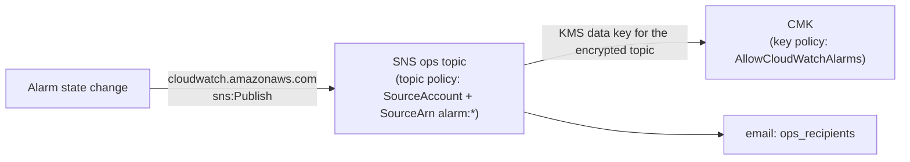

# modules/observability

CloudWatch alarms, two log metric filters and one dashboard. Together they
answer, for every boundary of the PyroSense pipeline, "who finds out if this
fails?". Every alarm notifies the KMS-encrypted ops topic of `modules/alerting`
on `ALARM` and on `OK`.

Design decisions: [ADR-0021](../../docs/adr/ADR-0021-observability-signal-policy.md).

## What it creates

| Address | What | Why |
|---|---|---|
| `aws_cloudwatch_metric_alarm.this["<key>"]` ×10 | One alarm per signal (catalogue below) | Each fault pages once, at the layer where it first becomes visible (ADR-0021 D1) |
| `aws_cloudwatch_log_metric_filter.transient_failures` | `{ $.message = "Processing failed*" }` on the ingest log group → `TransientFailures` | `handler.py` swallows per-message exceptions, so Lambda `Errors` never sees them |
| `aws_cloudwatch_log_metric_filter.rule_error_documents` | `{ $.ruleName = "<rule>" }` on the IoT rule error log group → `RuleErrorDocuments` | Dashboard cross-check: `Failure − RuleErrorDocuments` = payloads lost without trace |
| `aws_cloudwatch_dashboard.pipeline` | `<name_prefix>-pipeline` | Both sides of every boundary, in data-flow order |

It creates no IAM, no KMS key, no log group and no data store.

## Alarm catalogue

All alarms are named `<name_prefix>-<key>`, have `actions_enabled = true` (demo
included) and send `alarm_actions` and `ok_actions` to `ops_topic_arn`.

| Key | Metric (namespace) | Stat | Condition | Period × eval (M of N) | Missing data | Fault it detects | Runtime test |
|---|---|---|---|---|---|---|---|
| `telemetry-silence` | `TopicMatch` (`AWS/IoT`, `RuleName`) | Sum | `< 1` | 300 s × silence/5 (all) | **breaching** | Fleet silent: sensors down, certificate revoked, publisher stopped, rule disabled | Real path: stop publishing; fires `telemetry_silence_minutes` after the last message |
| `iot-publish-auth-errors` | `PublishIn.AuthError` (`AWS/IoT`, `Protocol=MQTT`) | Sum | `≥ 1` | 300 s × 1 | notBreaching | Publishes denied at the edge (lost telemetry, or probing). Account-wide | Real path: R6 of `RUNBOOK-iot.md` (`device_id` outside `PYRO-T?-????`) |
| `iot-rule-sqs-failures` | `Failure` (`AWS/IoT`, `RuleName`, `ActionType=SQS`) | Sum | `≥ 1` | 60 s × 1 | notBreaching | Rule could not write to the queue; payload only in the error log | Real path: R8 of `RUNBOOK-iot.md` (temporary removal of the `forward` role policy — drift, labelled) |
| `queue-oldest-message-age` | `ApproximateAgeOfOldestMessage` (`AWS/SQS`, ingest queue) | Maximum | `> 2 × VT` (360 s in demo) | 60 s × 3 (3 of 3) | notBreaching | Queue not drained: ESM disabled or unable to decrypt, saturation | Real path: ESM disabled by CLI while publishing (drift, labelled, re-enabled) |
| `dlq-not-empty` | `ApproximateNumberOfMessagesVisible` (`AWS/SQS`, DLQ) | Maximum | `≥ 1` | 60 s × 1 | **ignore** | A message exhausted its 5 receives (contract violation or persistent dependency failure) | Real path: T4 of `RUNBOOK-ingest.md`; first CloudWatch → encrypted SNS test (debt #31) |
| `lambda-errors` | `Errors` (`AWS/Lambda`) | Sum | `≥ 1` | 60 s × 1 | notBreaching | Invocation failed: config error at cold start, timeout, OOM, exception outside the per-message loop | `set-alarm-state` (tests the action, not the condition) |
| `lambda-throttles` | `Throttles` (`AWS/Lambda`) | Sum | `≥ 1` | 60 s × 1 | notBreaching | Account concurrency exhausted (the ESM caps itself at 2) | `set-alarm-state` |
| `transient-failures` | `TransientFailures` (`PyroSense/LogSignals/<env>`) | Sum | `≥ 1` | 60 s × 5 (3 of 5) | notBreaching | Per-message S3 / DynamoDB / SNS / KMS / IAM failures | Real path: same injection as `alert-publish-failures` while publishing |
| `alert-publish-failures` | `AlertPublishFailures` (`PyroSense/Ingest`, `Environment`) | Sum | `≥ 1` | 60 s × 1 | notBreaching | A fire alert was lost (ADR-0005, ADR-0015 D2) | Real path: temporary Deny on the fire topic policy by CLI (drift, labelled; next apply restores it) + CRITICAL payload |
| `fire-alert-delivery-failures` | `NumberOfNotificationsFailed` (`AWS/SNS`, fire topic) | Sum | `≥ 1` | 300 s × 1 | notBreaching | SNS gave up delivering an alert | `set-alarm-state` |

Why each `treat_missing_data`:

- **notBreaching.** Lambda, IoT and SNS failure counters emit nothing while
  nothing happens, so absence means healthy.
- **breaching.** Absence is the fault. This applies only to the heartbeat.
- **ignore.** SQS stops emitting metrics for a queue that nothing touches for
  six hours, *even if it holds messages*. With `notBreaching` the DLQ alarm
  would clear while the evidence is still inside.

### Not alarmed (dashboard only)

| Signal | Why no alarm |
|---|---|
| `InvalidPayloads` | Counts attempts (×5 per message). The DLQ alarm pages once per broken message (debt #9). |
| `Connect.AuthError` | A fleet that cannot connect pages through `telemetry-silence`. Other connect failures are not actionable. |
| `RuleErrorDocuments` | Same event as `iot-rule-sqs-failures`, and it depends on the error action working. |
| Lambda `Duration` | Max 1715 ms against a 30 s timeout (2026-10-07). A timeout already pages via `lambda-errors` (ADR-0021 D5). |
| DynamoDB `ThrottledRequests` / `SystemErrors` | A failed `PutItem` surfaces as `transient-failures`. CloudWatch also always ignores missing data on `AWS/DynamoDB` alarms. |
| `ConditionalCheckFailedRequests` | Produced on purpose by dedup (ADR-0008) and suppression (ADR-0005). |
| ESM `metrics_config` (`EventCount`) | Not enabled: it would modify `modules/ingest`, and queue age covers "ESM not consuming". |

## Inputs

| Name | Type | Source in the root | Validation |
|---|---|---|---|
| `name_prefix` | string | `local.name_prefix` | `^[a-z0-9-]{1,64}$` |
| `environment` | string | `var.environment` | `demo` \| `prod` |
| `queue_name` | string | `module.messaging.queue_name` | non-empty |
| `dlq_name` | string | `module.messaging.dlq_name` | non-empty |
| `queue_visibility_timeout_seconds` | number | `module.messaging.visibility_timeout_seconds` (**new output**) | integer 1–43200 |
| `function_name` | string | `module.ingest.function_name` | non-empty |
| `function_timeout_seconds` | number | `local.ingest_lambda_timeout_seconds` | 1–900 |
| `ingest_log_group_name` | string | `module.ingest.log_group_name` | non-empty |
| `metrics_namespace` | string | `module.ingest.metrics_namespace` | non-empty |
| `topic_rule_name` | string | `module.iot.topic_rule_name` | `^[a-zA-Z0-9_]{1,128}$` |
| `rule_error_log_group_name` | string | `module.iot.rule_error_log_group_name` | non-empty |
| `fire_alerts_topic_name` | string | `module.alerting.fire_alerts_topic_name` | non-empty |
| `ops_topic_arn` | string | `module.alerting.ops_topic_arn` | standard SNS topic ARN |
| `telemetry_silence_minutes` | number | root `local` (policy, ADR-0021 D2; provisional 10) | multiple of 5, 5–1440 |

There is no `kms_key_arn` input. The alarms reach the encrypted topic as a
service principal, authorized by the key policy and the topic policy. This
module encrypts nothing of its own (debt #22).

Derived inside the module:

- **Queue-age threshold** = 2 × VT. A transiently failing message is received
  at most three times before SQS drops it from the age metric, so a healthy
  queue stays under two visibility timeouts.
- **Silence evaluation periods** = `telemetry_silence_minutes / 5`.
- **Log-metric namespace** = `PyroSense/LogSignals/<environment>`. A metric
  filter cannot add a constant dimension, so the environment goes in the
  namespace.

## Outputs

| Output | Consumer |
|---|---|
| `alarm_name_prefix` | `aws cloudwatch describe-alarms --alarm-name-prefix`, destroy check |
| `alarm_names` | Map key → name for `describe-alarm-history` / `set-alarm-state --alarm-name` |
| `dashboard_name` | `aws cloudwatch get-dashboard --dashboard-name` |
| `log_metrics_namespace` | `get-metric-statistics --namespace` for the log-derived metrics |

## Contracts this module depends on

| Contract | Owner | Breaks how |
|---|---|---|
| Log message prefix `Processing failed` (JSON field `message`) | `src/ingest_lambda/handler.py` | `transient-failures` goes permanently quiet. Pinned by a test (`PYTHON-PROPOSALS-observability.md` O1). |
| EMF counter `AlertPublishFailures`, dimension `Environment`, emitted on every invocation | P1 (`fix/alert-publish-observability`) | `alert-publish-failures` never fires (O2). |
| Error-document field `ruleName` | AWS IoT (documented format) | `RuleErrorDocuments` stays at 0. |
| `ActionType=SQS` dimension value | AWS IoT (observed at runtime 2026-10-06; not enumerated in the docs) | `iot-rule-sqs-failures` watches a series that never exists. Checked with `list-metrics` in the runbook. |
| Key policy `AllowCloudWatchAlarms` | `modules/security` | Every alarm action fails. Visible only in `describe-alarm-history`. |
| Topic policy `AllowCloudWatchAlarms` (ops) | `modules/alerting` | Same. |

## IAM / KMS

Nothing is granted here. The path an alarm action takes:



The first alarm that fires for real is the first use of both statements (debts
#30 and #31). The key policy statement is hardened in a second apply, after
that first proof (`VERIFIED-MODULE-CHANGES-observability.md` §2).

## Cost (us-east-1)

| Item | Unit price | Demo (cycle ≈ 1 day) | Prod (month) |
|---|---|---|---|
| 10 standard alarms | $0.10 per alarm metric-month [V pricing examples] | ≈ $0.03 [I: prorated], $0 inside the 10-alarm free tier | $1.00 |
| 2 metric-filter metrics + `AlertPublishFailures` | $0.30 per custom metric-month (first 10,000) [V] | ≈ $0.03 [I] | $0.90 |
| Dashboard | 3 free per month [V]; paid price not rendered [?] | $0 | $0 (1 dashboard) |
| Alarm emails | SNS email: 1,000 free per month [V, alerting] | $0 | $0 |
| Metric filter evaluation | No charge rendered on the pricing page [?] | — | — |

Total ≈ **$1.90/month in prod**, independent of traffic. The module adds no log
ingestion: the filters read lines the function already writes.

## Verification

### Static (from the root)

`terraform fmt -check -recursive`, `terraform validate`, `tflint --recursive`,
`trivy config . --tf-vars demo.tfvars` (read the log).

### Plan (`jq` over `terraform show -json tfplan`)

```bash
jq -r '[.resource_changes[] | select(.module_address=="module.observability" and .mode=="managed") | .address] | sort[]' tfplan.json
# Expected: 13 addresses — the dashboard, 2 metric filters, 10 alarms keyed:
# alert-publish-failures, dlq-not-empty, fire-alert-delivery-failures,
# iot-publish-auth-errors, iot-rule-sqs-failures, lambda-errors,
# lambda-throttles, queue-oldest-message-age, telemetry-silence, transient-failures

jq '.resource_changes[] | select(.module_address=="module.observability" and .type=="aws_cloudwatch_metric_alarm") | {k: .index, ns: .change.after.namespace, m: .change.after.metric_name, d: .change.after.dimensions, s: .change.after.statistic, t: .change.after.threshold, op: .change.after.comparison_operator, tmd: .change.after.treat_missing_data, actions_unknown: .change.after_unknown.alarm_actions}' tfplan.json
# Expected: values as in the catalogue; dimensions carry the real names
# (pyrosense-demo-ingest, pyrosense_demo_telemetry_to_sqs, ...);
# alarm_actions unknown (true) because the ops topic is created in the same plan.
```

### Runtime

The runtime procedure is `RUNBOOK-observability.md`, delivered in the
execution phase. Each alarm is tested by its real path where one exists without
clickops. Where it does not, the test is `set-alarm-state`, which proves the
action path but not the condition. Every temporary change is labelled as drift.

## Known risks and what is not verified

| # | Item | Status |
|---|---|---|
| 1 | Metric filters on a log group encrypted with a CMK | [?] Not stated in the docs. EMF extraction on the CMK-encrypted ingest log group works (runtime 2026-10-07), which suggests ingest-time processing is unaffected. Proven by the `transient-failures` and `RuleErrorDocuments` runtime tests. |
| 2 | `ActionType` value `SQS` | [I] Observed at runtime in the iot cycle; not enumerated in the docs. |
| 3 | Whether CloudWatch populates `aws:SourceArn` / `aws:SourceAccount` on the KMS calls for the encrypted topic | [?] Decides debt #30. Proven by the second apply. |
| 4 | Initial state of a new alarm | [?] Not stated on the missing-data page. Observed after apply. |
| 5 | `PublishIn.AuthError` is account-wide | Accepted: any MQTT client of the account can trigger it. |
| 6 | The DLQ alarm stays `INSUFFICIENT_DATA` if the DLQ never becomes active after creation | [I] Expected `OK` after apply: creation calls `GetQueueAttributes`, which activates the queue. |
| 7 | A single failing message under low traffic | Retries every 180 s, so it never fills 3 of 5 minutes. It pages through the DLQ after ~15 min instead. By design. |
| 8 | Whether a throttled SQS invocation consumes a receive (debt #65) | Not documented. Inherited; `lambda-throttles` makes it visible. |
| 9 | Paid dashboard price and metric-filter charges | Not rendered on the pricing page. |
